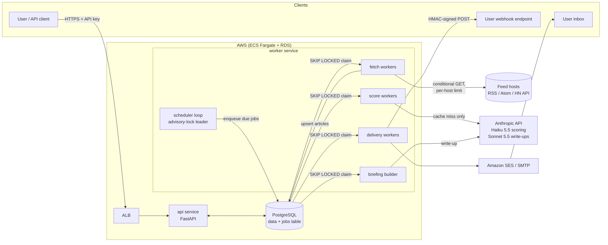
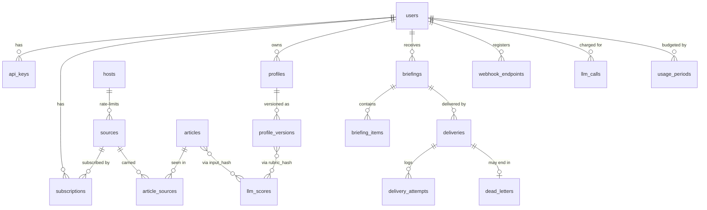

# briefing-engine: design plan

**Status:** draft for review, revision 2. No code yet.
**Author:** Simon O'Connor
**Last updated:** 2026-11-08. Revision 2 settles 50 gaps found while writing the learning guide; see the [revision history](#17-revision-history).

This document comes before the code. Every section is a proposal: where a choice was made, the options and the reasoning are written down (see [Decision records](#15-decision-records)), and anything still undecided is listed under [Open questions](#16-open-questions).

---

## Contents

1. [Context](#1-context)
2. [Goals and non-goals](#2-goals-and-non-goals)
3. [Architecture overview](#3-architecture-overview)
4. [Data model](#4-data-model)
5. [REST API](#5-rest-api)
6. [Ingestion](#6-ingestion)
7. [LLM layer](#7-llm-layer)
8. [Delivery](#8-delivery)
9. [Job queue and worker](#9-job-queue-and-worker)
10. [Testing strategy](#10-testing-strategy)
11. [Deployment (AWS)](#11-deployment-aws)
12. [Observability](#12-observability)
13. [Case-study metrics](#13-case-study-metrics)
14. [Milestones](#14-milestones)
15. [Decision records](#15-decision-records)
16. [Open questions](#16-open-questions)
17. [Revision history](#17-revision-history)

---

## 1. Context

Right now my daily AI briefing comes from [Horizon](https://github.com/Thysrael/Horizon), an open-source aggregator, run by a Windows scheduled task at 06:30 from `C:\dev\AI News`. It reads 14 RSS feeds plus the Hacker News top stories (score ≥ 100), scores items with `claude-sonnet-5-5` under two profiles (`ai-news` with threshold 6.0, `tech-blog` with threshold 5.0), extracts full text for some feeds with trafilatura, and sends the result over SMTP.

Getting it running took three upstream fixes (Thysrael/Horizon#220–#222). Each one points at a design requirement here:

| Horizon bug | What it teaches | Where this plan handles it |
|---|---|---|
| Anthropic rejected `temperature` ("Extra inputs are not permitted") and the fallback didn't recognise the error | Sampling parameters were removed from the API (on API version `2026-10-21` they 400 on every model). Don't send parameters the API doesn't need, and sort errors into kinds rather than matching message strings. | §7.2, §7.4 |
| Reddit RSS returned 429 when requests came in bursts | Rate-limit per host, honour `Retry-After`, and back off with jitter. Reddit's HTML and JSON routes return 403, so RSS is the only supported route. | §6.2, §6.3 |
| HTML in the email was escaped twice | Escape at exactly one layer, the template, and test it with golden files. | §8.1 |

Horizon is mostly configuration. This project is the replacement, written from scratch: a multi-user service that shows backend work (queues, idempotency, rate limiting, caching, cost control, signed webhooks, infrastructure as code) and is small enough that I can defend every line.

---

## 2. Goals and non-goals

### Goals

1. **Replace Horizon for my own briefing** (stage 1), delivered on time every day, with quality at least as good.
2. **Multi-user by design.** Sources and articles are shared. Rubrics, briefings, budgets and delivery settings belong to each user. Fetching and scoring scale with the number of distinct sources and rubrics, not with users × sources.
3. **Be polite to upstream hosts.** Per-host rate limits, `Retry-After`, conditional requests, an identifying User-Agent.
4. **Every step is idempotent.** Re-running any job, or a whole day, gives the same result, sends no duplicate email, and costs close to nothing.
5. **Cost is a visible, controlled quantity.** Every LLM call is recorded with its token counts and cost. Each user has a budget that can't be exceeded, even under concurrency.
6. **Measurable.** The system records the numbers the case study needs (§13) from day one.
7. **Deployable from scratch** with one `terraform apply` and a CI pipeline, with no hand-configured AWS resources.

### Non-goals

- **Web UI.** The interface is the REST API plus the email. OpenAPI docs come free with FastAPI.
- **Self-service sign-up, OAuth, social login.** Users are created by an admin CLI and authenticate with API keys.
- **Scraping that sites don't offer.** No headless browsers, no paywall workarounds, no Reddit HTML or JSON routes. Full-text extraction (as Horizon does with trafilatura) runs only for sources flagged for it, goes through the same per-host limiter, and is used only as LLM input. It is not republished.
- **Near-duplicate detection** (SimHash or MinHash for the same story under different wording). Exact deduplication by URL and content hash is in scope. Grouping articles about the same story is handed to the write-up model (§7.6), and proper clustering is future work.
- **Real-time or streaming delivery.** Briefings are batch: daily, or on demand through the API.
- **Multi-region, high availability or a production SLA.** Single region, single-AZ RDS. The plan notes where production would differ.
- **Recommendation ML or learning from clicks.** Scoring is rubric-driven and explainable.

---

## 3. Architecture overview

One Python codebase and one Docker image, run in two modes:

- **`api`**: FastAPI behind an ALB. Handles user-facing CRUD, briefing reads and on-demand triggers.
- **`worker`**: long-running job workers plus a scheduler loop, which only one worker runs at a time (a Postgres advisory lock decides which).

The mode is chosen by **CLI subcommand**. The image's `ENTRYPOINT` is `briefing` with a default `CMD` of `api`. `briefing api` starts uvicorn from inside the program, so its settings live in code. `briefing worker` starts the worker, and `briefing migrate` runs the migrations. Each ECS task definition sets its `command`, so one image serves all three without environment-variable switches.

PostgreSQL is the system of record **and** the job queue. External dependencies are feed hosts, the Anthropic API, Amazon SES (or SMTP in stage 1) and user webhook endpoints.



### Pipeline for one day

```mermaid
sequenceDiagram
    autonumber
    participant S as Scheduler
    participant Q as jobs (Postgres)
    participant F as Fetch worker
    participant SC as Score worker
    participant B as Briefing builder
    participant D as Delivery worker

    S->>Q: enqueue fetch(source) for each due source (dedupe_key)
    Q->>F: claim
    F->>F: host slot? conditional GET → 304 or parse
    F->>Q: upsert articles; enqueue score(article, rubric) for each subscribed rubric on cache miss
    Q->>SC: claim (batched by rubric)
    SC->>SC: Haiku 5.5, structured output, validate → llm_scores
    S->>Q: at user's build time: enqueue build_briefing(user, date)
    Q->>B: claim
    B->>B: rank cached scores → Sonnet 5.5 write-up → briefings row
    B->>Q: enqueue deliver(briefing, channel) (unique per channel)
    Q->>D: claim → email / signed webhook, retries → dead_letters
```

### Code layout (proposed)

```
src/briefing_engine/
  api/            FastAPI routers, auth dependency, pagination, problem+json errors
  ingest/         fetcher, host limiter, retry policy, feed parsers, url/content normalisation
  llm/            client wrapper, prompts, schemas, scorer, writer, cache, cost/pricing, budgets
  delivery/       email renderer + sender, webhook signer + sender
  queue/          jobs table access, worker loop, leases, scheduler
  db/             SQLAlchemy Core tables, repositories, Alembic migrations
  observability/  logging config, metrics, health
  cli.py          admin + ops commands (create-user, run-daily, replay, import-horizon-config)
tests/
  unit/  integration/  e2e/  fixtures/
infra/            Terraform
```

---

## 4. Data model

PostgreSQL 17. Ids are `bigint generated always as identity` for internal tables and `uuid` (v7, so they sort by time) for ids that appear in the API. Times are `timestamptz` in UTC. Money is stored as **integer micro-dollars** (`bigint`, where 1 USD = 1,000,000) so there's no float rounding in budgets.

**Where UUID v7 values come from.** They're generated **in application code**, never by a column default. PostgreSQL 17 has no `uuidv7()` (it arrived in 18). Python's `uuid.uuid7()` arrived in 3.14, which this plan now targets (Q13). If we stay on 3.13, the `uuid6` package provides the same function behind the same one-line helper (`db/ids.py: new_id()`). Generating ids in the app has a second benefit: the id exists before the insert, so it can go straight into log lines and job payloads.

**Rounding money.** Prices are stored as integer micro-dollars per million tokens (Haiku 5.5 input is `100_000`). Each call's cost is calculated exactly and **rounded up once per call** to a whole micro-dollar, using integer arithmetic only:

```python
cost_micros = ceil_div(sum(tokens[t] * price_per_mtok_micros[t] for t in token_types), 1_000_000)
```

A 451-token Haiku input costs 45.1 µ$ and is stored as 46. Rounding up keeps budgets conservative. Because it happens once per call, not once per token type, the bias is under 1 µ$ per call, roughly $0.0003 a day.

### 4.1 Entity overview



### 4.2 Tables

**Identity and auth**

| Table | Key columns | Constraints / indexes |
|---|---|---|
| `users` | `id uuid`, `email citext`, `display_name`, `timezone text` (IANA), `send_time time` (local), `monthly_budget_micros bigint`, `email_enabled bool default true` (cleared by one-click unsubscribe, §8.1), `is_system bool default false`, `created_at`, `disabled_at` | `UNIQUE(email)`; partial `UNIQUE(is_system) WHERE is_system`, so there is exactly one system user. The **system user** has no API keys and no email. It owns shared work: preset rubrics, shared article enrichment, model evaluations and the live smoke test (ADR-013). |
| `api_keys` | `id uuid`, `user_id`, `prefix char(12)`, `secret_hash bytea` (SHA-256), `name`, `scopes text[]`, `created_at`, `last_used_at`, `expires_at`, `revoked_at` | `UNIQUE(prefix)`; `INDEX(user_id)`. Lookup is by prefix, then a constant-time compare of the hash. |

**Sources and ingestion**

| Table | Key columns | Constraints / indexes |
|---|---|---|
| `hosts` | `host text PK`, `min_interval_ms int` (default 2000), `next_allowed_at timestamptz`, `blocked_until timestamptz` (from `Retry-After`), `notes` | One row per host. This is the shared state the per-host limiter works from (§6.2). |
| `sources` | `id`, `kind` (`rss`, `atom`, `hn_top`), `url`, `url_normalised`, `host` FK, `extract_full_text bool`, `etag`, `last_modified`, `last_body_sha256`, `base_interval interval` (default 30 min), `fetch_interval interval`, `unchanged_count int`, `next_fetch_at`, `consecutive_failures int`, `status` (`active`, `paused`, `broken`) | `UNIQUE(url_normalised)`, so users who add the same feed share one source. Partial index `(next_fetch_at) WHERE status = 'active'`. |
| `subscriptions` | `id uuid`, `user_id`, `source_id`, `profile_id`, `weight real default 1.0`, `created_at` | `UNIQUE(user_id, source_id)`; `INDEX(user_id, created_at, id)` for keyset pagination |
| `fetch_log` | `id`, `source_id`, `started_at`, `attempt`, `status_code`, `conditional_sent bool`, `outcome` (`ok`, `not_modified`, `unchanged_body`, `retryable_error`, `fatal_error`, `rate_limited`), `retry_after_s`, `bytes`, `duration_ms`, `error` | `INDEX(source_id, started_at DESC)`; 30-day retention. Raw data for the metrics in §13. |

**Articles and deduplication**

| Table | Key columns | Constraints / indexes |
|---|---|---|
| `articles` | `id`, `url_canonical`, `url_hash bytea` (SHA-256 of the normalised URL), `content_hash bytea` (dedup identity, from feed fields only), `input_hash bytea` (hash of the exact text the scorer sees, §6.5), `duplicate_of bigint NULL`, `title`, `author`, `published_at`, `first_seen_at`, `last_seen_at`, `summary_text` (from the feed), `body_text` (extracted, truncated to 20k characters), `hn_points int NULL`, `hn_comments_url` | `UNIQUE(url_hash)`; `INDEX(content_hash)`; `INDEX(first_seen_at, id)` (serves keyset pagination in both directions); partial `INDEX(duplicate_of) WHERE duplicate_of IS NOT NULL` |
| `article_sources` | `article_id`, `source_id`, `first_seen_at` | `PRIMARY KEY(article_id, source_id)`. Records "seen in 3 feeds", which feeds into ranking. |

The deduplication rules (detail in §6.5):

1. **Same normalised URL means the same article.** This is enforced by `UNIQUE(url_hash)` and `INSERT … ON CONFLICT (url_hash) DO UPDATE SET last_seen_at = now()`.
2. **Same content hash at a different URL means a syndicated copy.** The new row is kept for provenance, but `duplicate_of` points at the earliest **original** with that hash (an article whose own `duplicate_of` is null) first seen within the last 14 days. Because only originals are ever pointed at, a copy can never point at another copy. If the only match is older than 14 days, the new row becomes an original: the story is news again. A copy is never scored separately and never appears twice in a briefing.
3. **Same URL with new feed content** (an edited article): `content_hash` and `input_hash` are updated in place. Scores are keyed by input hash, so the article is re-scored only if it's still inside the briefing window.
4. **Full-text extraction never changes `content_hash`.** The content hash is built from feed fields only (title and summary), so it's known at fetch time and is the same for every copy whatever extraction did later. Extraction changes only `input_hash`, because it changes what the scorer reads (ADR-005).

**Profiles and rubrics**

| Table | Key columns | Constraints / indexes |
|---|---|---|
| `profiles` | `id uuid`, `user_id`, `name` (for example `ai-news`), `current_version int`, `threshold real`, `max_items int` | `UNIQUE(user_id, name)` |
| `profile_versions` | `profile_id`, `version int`, `rubric jsonb`, `rubric_hash bytea`, `created_at` | `PRIMARY KEY(profile_id, version)`. Rows are never changed: editing a rubric inserts a new version. `rubric_hash` is SHA-256 of the canonical JSON of the rubric (sorted keys, no whitespace). |

**LLM cache, ledger and budgets**

| Table | Key columns | Constraints / indexes |
|---|---|---|
| `llm_scores` | `input_hash`, `rubric_hash`, `model`, `prompt_version`, `score smallint` (0–10), `reason text`, `topics text[]`, `method` (`llm`, `llm_retry`), `llm_call_id`, `created_at` | `PRIMARY KEY(input_hash, rubric_hash, model, prompt_version)`. This **is** the score cache (§7.5). Only valid scores are stored. Failures are never cached. |
| `llm_writeups` | `cache_key bytea PK` (hash of the sorted input hashes, rubric hash, model and prompt version), `output jsonb`, `llm_call_id`, `created_at` | A write-up cache, so re-running a day is free. |
| `llm_calls` | `id`, `user_id NOT NULL` (shared work is charged to the system user, never null), `reservation_id`, `purpose` (`score`, `writeup`, `enrich`, `eval`, `smoke`), `model`, `request_id`, `input_tokens`, `output_tokens`, `cache_read_tokens`, `cache_write_tokens`, `cost_micros`, `estimate_micros`, `latency_ms`, `outcome` (`ok`, `invalid_output`, `refusal`, `max_tokens`, `api_error`), `created_at` | `INDEX(user_id, created_at)`. One row per API call: the cost ledger. |
| `llm_cache_hits` | `user_id`, `purpose`, `saved_cost_micros`, `created_at` | Append-only; can be rolled up by day. Records what each cache hit *would have* cost, which gives the "before caching" number in §13. |
| `usage_periods` | `user_id`, `period_start date` (first of the month, in UTC), `limit_micros`, `reserved_micros`, `spent_micros` | `PRIMARY KEY(user_id, period_start)`; `CHECK (reserved_micros >= 0 AND spent_micros >= 0)`. The budget-enforcement row (§7.7). **Created lazily** by the first reservation of a month (`INSERT … ON CONFLICT DO NOTHING`, copying `limit_micros` from `users.monthly_budget_micros`). The CLI command `set-budget` updates both the user and the current month's row. |
| `budget_reservations` | `id uuid`, `user_id`, `period_start`, `amount_micros`, `purpose`, `expires_at`, `settled_at NULL`, `released_at NULL` | Partial `INDEX(expires_at) WHERE settled_at IS NULL AND released_at IS NULL`. One row per reservation, so the reaper can release exactly the reservations that expired (§7.7). |

**Briefings and delivery**

| Table | Key columns | Constraints / indexes |
|---|---|---|
| `briefings` | `id uuid`, `user_id`, `profile_id`, `profile_version`, `briefing_date date` (the user's local date), `revision int default 1` (incremented by a forced rebuild, §6.6), `status` (`building`, `ready`, `degraded`, `failed`), `writeup jsonb`, `cost_micros`, `created_at`, `ready_at` | `UNIQUE(user_id, profile_id, briefing_date)`. This is what makes re-runs idempotent. `INDEX(user_id, briefing_date, id)` for keyset pagination. |
| `briefing_items` | `briefing_id`, `article_id`, `rank smallint`, `score smallint`, `blurb text`, `group_key text NULL` | `PRIMARY KEY(briefing_id, article_id)`; `UNIQUE(briefing_id, rank)` |
| `webhook_endpoints` | `id uuid`, `user_id`, `url`, `secret_ciphertext bytea` (current), `previous_secret_ciphertext bytea NULL`, `previous_secret_expires_at`, `event_types text[]`, `status` (`active`, `disabled`), `consecutive_dead int`, `created_at` | `INDEX(user_id)` |
| `deliveries` | `id uuid` (also the webhook event id), `briefing_id`, `briefing_revision int`, `channel` (`email`, `webhook`), `endpoint_id NULL`, `status` (`pending`, `in_flight`, `succeeded`, `dead`), `attempts int`, `next_attempt_at`, `last_error` | `UNIQUE NULLS NOT DISTINCT (briefing_id, briefing_revision, channel, endpoint_id)`: at most one delivery per briefing revision per destination. |
| `delivery_attempts` | `delivery_id`, `attempt int`, `started_at`, `status_code`, `duration_ms`, `error`, `response_excerpt` (first 512 bytes) | `PRIMARY KEY(delivery_id, attempt)` |
| `dead_letters` | `id`, `kind` (`delivery`, `job`), `ref_id`, `payload jsonb`, `last_error`, `failed_at`, `replayed_at NULL` | `INDEX(failed_at) WHERE replayed_at IS NULL` |

**Queue** (detail in §9)

| Table | Key columns | Constraints / indexes |
|---|---|---|
| `jobs` | `id bigint`, `queue text` (`fetch`, `extract`, `score`, `build`, `deliver`, `maintenance`), `kind`, `payload jsonb`, `dedupe_key text NULL`, `group_key text NULL` (the rubric hash for score jobs, §9.1), `state` (`queued`, `running`, `succeeded`, `dead`), `priority smallint`, `run_at`, `attempts`, `max_attempts`, `deferrals int`, `locked_by`, `lease_expires_at`, `last_error`, `created_at`, `finished_at` | Partial `UNIQUE(dedupe_key) WHERE state IN ('queued', 'running')`; partial `INDEX(queue, priority DESC, run_at) WHERE state = 'queued'`; partial `INDEX(queue, group_key, run_at) WHERE state = 'queued'`; partial `INDEX(lease_expires_at) WHERE state = 'running'`. There is no `failed` state: a failure that will be retried goes back to `queued`, and one that won't becomes `dead`. |
| `workers` | `id text PK`, `started_at`, `last_heartbeat_at`, `version` | Used for monitoring and for alerting on stuck workers. It is **not** the container health check (§12.3). |

**API support**

| Table | Key columns | Constraints / indexes |
|---|---|---|
| `idempotency_keys` | `user_id`, `key text`, `request_hash bytea` (SHA-256 of method, path and canonical body), `state` (`in_progress`, `completed`), `response_status smallint`, `response_body jsonb`, `locked_until`, `created_at`, `expires_at` (24 h) | `PRIMARY KEY(user_id, key)`; `INDEX(expires_at)`. Behaviour in §5.1. |
| `schema_meta` | `schema_version int` (one row) | Set by every migration. Readiness compares it with the code's minimum (§4.3). |

### 4.3 Migrations

Alembic with a linear history, forward-only once the database is deployed. Every migration must work with the code version **before** it as well as after it, because migrations run before new code starts (§11.2) and old tasks keep serving during the rollout.

A schema change that would break the running version uses expand/contract, in this order:

1. **Expand:** a migration adds the new column or table, nullable and with no constraints yet.
2. **Dual-write deploy:** code that writes both the old and the new form, and still reads the old one.
3. **Backfill:** a batched, re-runnable job (`UPDATE … WHERE new_col IS NULL … LIMIT 5000`, looped until it touches 0 rows). Rows written by the old code during the rollout are still null, so the backfill runs **again after the dual-write deploy has fully replaced the old tasks**. Because it only touches null rows, the second run is cheap and catches everything the first one missed.
4. **Constrain:** a migration adds `NOT NULL` or other constraints (`NOT VALID` first, then `VALIDATE CONSTRAINT`, so the table isn't locked).
5. **Switch deploy:** code reads and writes only the new form.
6. **Contract:** a later migration drops the old column.

Each migration also sets `schema_meta.schema_version` to its own sequence number. The code declares `MIN_SCHEMA_VERSION`, the oldest schema it can run on. Readiness checks `schema_version >= MIN_SCHEMA_VERSION` rather than "the database is at exactly my revision", so old tasks stay ready after a newer migration has run (§12.3).

CI applies every migration to an empty database, and checks that the tables Alembic generates match the ones the code defines.

---

## 5. REST API

### 5.1 Conventions

- Base path `/v1`, JSON only, UTF-8.
- **Auth:** `Authorization: Bearer <key>`. See §5.3.
- **Errors:** RFC 9457 `application/problem+json` with `type`, `title`, `status`, `detail` and a `request_id`. Validation errors list each failing field.
- **Request ids:** an `X-Request-Id` header is accepted, or generated, and echoed back. It appears in every log line.
- **Idempotency:** `POST` requests that create work (`/briefings`, `/deliveries/{id}/replay`) accept an `Idempotency-Key` header, stored in `idempotency_keys` for 24 hours. The flow:
  1. `INSERT … (state = 'in_progress', locked_until = now() + 60 s) ON CONFLICT DO NOTHING`. If the row was inserted, this request owns the key: run the handler, then store the status and body and set `state = 'completed'`, in the same transaction as the handler's own writes where possible.
  2. If the row already exists with a **different** `request_hash`, return `422` (problem type `idempotency-key-reused`).
  3. Same hash, `completed`: return the stored response with an `Idempotent-Replayed: true` header.
  4. Same hash, `in_progress` (a **concurrent** request with the same key): return `409 Conflict` with `Retry-After: 1`. The handler never runs twice at once.
  5. Same hash, `in_progress` but `locked_until` has passed (the first request crashed): take the key over with `UPDATE … WHERE locked_until < now()` and run as in step 1.

  A maintenance job deletes expired keys.
- **Authorisation failures:** a valid key without the needed scope gets `403`, problem type `insufficient-scope`, plus `WWW-Authenticate: Bearer error="insufficient_scope", scope="write"` (RFC 6750). A missing or invalid key gets `401`.
- **Rejected URLs:** a subscription or webhook URL that fails the SSRF guard (§6.1) gets `422`, problem type `url-not-allowed`, with the detail "resolves to a non-public address". The response doesn't say which address, so the endpoint can't be used to map internal DNS.
- **API rate limits** (stage 3): per-key token bucket. Over the limit returns `429` with `Retry-After`, plus `RateLimit-Limit`, `RateLimit-Remaining` and `RateLimit-Reset` headers. The service gives clients the same courtesy it expects from feed hosts.
- **Versioning:** additive changes stay in `/v1`. Breaking changes get a `/v2` router served alongside it.

### 5.2 Resources and endpoints

| Method and path | Purpose | Notes |
|---|---|---|
| `GET /v1/me` | The current user, their budget and their send time | |
| `PATCH /v1/me` | Update timezone, send time and display name | Validates the IANA timezone name |
| `GET /v1/api-keys` | List keys (prefix, name, last used) | The secret is never returned |
| `POST /v1/api-keys` | Create a key | The **only** response that contains the full secret |
| `DELETE /v1/api-keys/{id}` | Revoke a key | Soft revoke (`revoked_at`), takes effect immediately |
| `GET /v1/subscriptions` | My feeds | Paginated |
| `POST /v1/subscriptions` | `{url, kind?, profile, weight?}`: subscribe | Normalises the URL, runs the SSRF guard, finds or creates the shared `source`, and answers `201` or `200` if already subscribed |
| `DELETE /v1/subscriptions/{id}` | Unsubscribe | A source with no subscribers is paused, not deleted |
| `GET /v1/profiles` / `POST /v1/profiles` | List or create rubric profiles | |
| `GET /v1/profiles/{id}` | Current version, threshold, max items | |
| `PUT /v1/profiles/{id}/rubric` | Replace the rubric, which **creates a new version** | Returns the new version number. Old scores stay cached under the old rubric hash. If the canonical hash equals the **current** version's hash, nothing is written and the answer is `200` with the current version (a PUT is idempotent). Going back to an **older** rubric creates a new version, so history stays linear, and its cached scores are hit straight away through the shared rubric hash. |
| `GET /v1/profiles/{id}/versions` | Version history | |
| `GET /v1/articles` | Scored articles for me. Filters: `profile`, `since`, `min_score`, `source_id` | Keyset pagination on `(first_seen_at DESC, id DESC)` |
| `GET /v1/briefings` | My briefings | Keyset on `(briefing_date DESC, id DESC)` |
| `GET /v1/briefings/{id}` | One briefing with its items | `id` may also be `YYYY-MM-DD?profile=ai-news` |
| `POST /v1/briefings` | Build one now: `{profile, date?}` | `202` with a `job_id`. Idempotent per (user, profile, date). |
| `GET /v1/jobs/{id}` | Job status (my jobs only) | |
| `GET /v1/webhook-endpoints` / `POST` | List or register endpoints | `POST` returns the signing secret once. SSRF guard; HTTPS required in production. |
| `DELETE /v1/webhook-endpoints/{id}` | Remove an endpoint | |
| `POST /v1/webhook-endpoints/{id}/rotate-secret` | New secret. The old one keeps working for 24 hours. | During the overlap, both signatures are sent |
| `POST /v1/webhook-endpoints/{id}/test` | Send a signed `ping` event | |
| `GET /v1/deliveries` | Filter by `status`, `channel` | Shows failures and dead letters |
| `POST /v1/deliveries/{id}/replay` | Re-send a dead delivery | Idempotency-Key supported |
| `GET /v1/usage` | `period=2026-11`: tokens and cost by purpose and model, budget left, cache savings | |
| `GET /v1/unsubscribe?token=…` / `POST` (same path) | One-click email unsubscribe (stage 2, with SES) | No API key. The token is `base64url(user_id ‖ HMAC-SHA256(unsubscribe_key, user_id ‖ "email"))`. `POST` is the RFC 8058 one-click target and sets `users.email_enabled = false`. `GET` shows a one-line confirmation page with a button that POSTs, so mail scanners that follow links don't unsubscribe anyone. Webhooks are unaffected. |
| `GET /healthz` / `GET /readyz` | Liveness and readiness | No auth. See §12.3. |

Admin actions (create a user, set a budget, pause a source) are **CLI commands that run against the database**, not HTTP endpoints. That keeps admin permissions out of the public API.

### 5.3 Per-user API keys

- **Format:** `bek_<12-char prefix>_<32 random bytes, base62>`. The `bek_` marker lets secret scanners (GitHub push protection, trufflehog) recognise the key and makes leaks easy to grep for. The prefix is a non-secret lookup id.
- **Storage:** the secret is stored as `SHA-256(secret)`, not bcrypt or argon2. The secret has 256 bits of entropy, so a fast hash can't be brute-forced, and it keeps auth to well under a millisecond (ADR-004). The comparison uses `hmac.compare_digest`.
- **Lookup:** parse the prefix, `SELECT … WHERE prefix = $1 AND revoked_at IS NULL AND (expires_at IS NULL OR expires_at > now())`, then compare the hash. Missing key, wrong secret and revoked key all return the same `401`.
- **`last_used_at`:** written at most once a minute per key, so authenticated reads don't each cause a write.
- **Scopes:** `read` and `write` in stage 2. They're enough to hand a read-only key to a dashboard. A missing scope gives `403` (§5.1).
- **Never logged.** The logging layer redacts `Authorization` headers and anything matching `bek_`.

### 5.4 Pagination

Keyset (cursor) pagination, not offset:

```
GET /v1/articles?limit=50&cursor=eyJ0IjoiMjAyNi0xMS0wOFQwNjozMDowMFoiLCJpZCI6MTIzNDV9
→ { "data": [...], "next_cursor": "…" | null }
```

- The cursor is opaque and signed, so clients can't tamper with it or depend on its contents. The exact format is `<payload>.<sig>`:
  - `payload` = base64url (no padding) of compact JSON: `{"v": 1, "r": "articles", "k": ["2026-11-08T06:30:00Z", 12345], "f": "<filter hash>"}`. `r` is the resource, `k` holds the sort-key values of the last row, and `f` is the first 8 bytes, in hex, of SHA-256 over the canonical query filters.
  - `sig` = base64url of the first 16 bytes of `HMAC-SHA256(CURSOR_HMAC_KEY, payload)`.
  - Checks: the signature is compared in constant time, `r` must match the endpoint, and `f` must match this request's filters. Any failure returns `400`, problem type `invalid-cursor`. Binding the cursor to its filters stops a client changing `min_score` halfway through a walk and silently skipping rows.
  - `v` lets the format change later. Rotating the key invalidates outstanding cursors, which is acceptable because they're short-lived.
- `limit` defaults to 50, maximum 200.
- The query is `WHERE (first_seen_at, id) < ($t, $id) ORDER BY first_seen_at DESC, id DESC LIMIT $n + 1`. Fetching one extra row tells us whether there's a next page without a `COUNT(*)`.
- **Each paginated list has a composite index matching its sort:** `articles (first_seen_at, id)`, `briefings (user_id, briefing_date, id)` and `subscriptions (user_id, created_at, id)` (§4.2). B-tree indexes can be scanned backwards, so the `DESC` order needs no separate index. `GET /v1/articles` is a join from the user's subscriptions to `article_sources` to `articles`. Its plan is checked with `EXPLAIN` in an integration test on the seeded load-test data set, and the test fails if the plan shows a sequential scan on `articles`.
- **Why:** pages stay stable while new articles are inserted (offset pagination skips or repeats rows), and the cost is constant at any depth because it uses an index. ADR-008.

---

## 6. Ingestion

### 6.1 Flow

1. The **scheduler** (each minute) selects sources where `status = 'active' AND next_fetch_at <= now()` and enqueues `fetch(source_id)` with `dedupe_key = 'fetch:{source_id}'`. The partial unique index means a source can't have two fetch jobs at once.
2. The **fetch worker** acquires a host slot (§6.2), sends a conditional GET (§6.4), and classifies the result (§6.3).
3. On `200`, it parses the feed with `feedparser` (the HN API uses its own adapter), normalises each entry (§6.5), and upserts `articles` and `article_sources`.
4. For each new or changed original (not a duplicate), what happens next depends on the source:
   - **No extraction:** find the rubrics of subscribers to this source and enqueue scoring for each (input_hash, rubric_hash) not already in `llm_scores`.
   - **`extract_full_text` set:** enqueue `extract(article_id)` instead. The **extract job enqueues the scoring** once `body_text` is stored and `input_hash` is recomputed, so an article is never scored on its summary and then again on its full text. If extraction ends up `dead`, its failure hook enqueues scoring on the summary, so the article is still scored.

   Every enqueue happens **in the same transaction** as the write it depends on (§9.1). Extraction uses the same per-host limiter. trafilatura runs on the fetched page, and `body_text` is truncated to 20k characters.
5. It sets `next_fetch_at = now() + fetch_interval`. The interval adapts, using `sources.unchanged_count`:
   - A fetch is **unchanged** if it returned `304`, a soft 304 (§6.4), or a `200` with no new or changed articles. It increments `unchanged_count`.
   - Any new or changed article resets `unchanged_count` to 0 and `fetch_interval` to `base_interval` (30 minutes by default).
   - When `unchanged_count` reaches 5, `fetch_interval` doubles (capped at 6 hours) and `unchanged_count` goes back to 0. So the next doubling needs another 5 unchanged fetches at the new, longer interval.
   - Failed fetches touch neither the counter nor the interval. Failures have their own path (§6.3).

HTTP client: `httpx` with a 5 s connect timeout and 20 s read timeout, at most 5 redirects, and a 5 MB response cap read as a stream (larger responses are aborted). The User-Agent is `briefing-engine/<version> (+https://github.com/simonoconnordev/briefing-engine)`. It identifies the service and gives a contact URL, and never a personal email address.

**SSRF guard** (needed once users submit URLs in stage 2): resolve the hostname, reject loopback, private (RFC 1918), link-local (including `169.254.169.254`, the AWS instance metadata service), CGNAT, multicast and IPv6 unique-local addresses. Check again on **every redirect hop**. Connect to the IP that was validated, so a DNS rebinding trick can't swap it after the check. Webhook URLs go through the same guard.

### 6.2 Per-host rate limiting

Workers run as several processes and tasks, so the limit is enforced in **Postgres**, not in memory. One row in `hosts` holds the next free slot:

```sql
UPDATE hosts
SET next_allowed_at = GREATEST(now(), next_allowed_at, COALESCE(blocked_until, now()))
                      + make_interval(secs => min_interval_ms / 1000.0)
WHERE host = $1
RETURNING next_allowed_at - make_interval(secs => min_interval_ms / 1000.0) AS my_slot;
```

- If `my_slot <= now()`, fetch now.
- If `my_slot` is in the future, **don't sleep while holding the job.** Store the slot in the job (`payload.host_slot = my_slot`), set `run_at = my_slot`, and release it as a **deferral** (§9.1: it uses up no attempt, and `deferrals` goes up by one). A worker never blocks on a slow host while other hosts are waiting.
- **One ticket per request.** When a deferred job runs again and `now()` is within 30 s after its `host_slot`, it **uses that slot without running the `UPDATE` again**. Otherwise it would take a second slot, which is now later than the first because the first advanced `next_allowed_at`, and it would be deferred for ever. If the job is more than 30 s late (a worker backlog), the slot has gone and it takes a new ticket. A retry after a failed request is a new request, so it always takes a new ticket.
- Before taking a ticket, a worker also checks `blocked_until`. If the host is blocked, the job is deferred to `blocked_until` plus jitter (§6.3), again without using an attempt.
- The row lock lasts as long as one `UPDATE`, so contention stays small.
- Defaults: 2 s between requests per host. Overrides are seeded per host. `www.reddit.com` gets 10 s, because both Horizon subreddit feeds hit it in the same minute, and that was the 429 burst.
- `blocked_until` is set from `Retry-After` (§6.3), so **every** source on that host waits, not only the one that got the 429.

Trade-off: a Postgres round-trip per fetch costs about 1 ms. At hundreds of fetches a minute that's nothing, and it saves running Redis. ADR-001 covers the general "Postgres first" choice.

### 6.3 Retries, backoff and `Retry-After`

**Classification** (one table in code, unit-tested):

| Result | Class | Action |
|---|---|---|
| `200` | ok | Parse |
| `304` | not modified | Record, don't parse |
| `429`, `503` with `Retry-After` | rate limited | Honour `Retry-After` and set `hosts.blocked_until` |
| `408`, `425`, `429`/`5xx` without a header, connection reset, timeout, DNS failure | retryable | Exponential backoff |
| `301`, `308` | permanent redirect | Update `sources.url` after the SSRF check, record the change |
| `401`, `403`, `404` | fatal for this run | `consecutive_failures++`. After 5 the source is marked `broken`. No retries within the run. |
| `410 Gone` | fatal, permanent | Mark `broken` immediately |
| Parse error, or more than 5 MB | fatal for this run | Record, count as a failure |

**`Retry-After` parsing** accepts both forms in RFC 9110: delta-seconds (`120`) and HTTP-date (`Wed, 21 Oct 2026 07:28:00 GMT`). Then **one** rule applies:

- Negative, unparsable, or an HTTP-date in the past: ignore the header and use normal backoff.
- Otherwise `wait = clamp(value, 1 s, 24 h)`. Set `hosts.blocked_until = now() + wait` **every time**, however long the wait. The host asked us to stay away, so every source on it waits. Values over 24 h are clamped and logged as `retry_after_anomaly`, so a misconfigured header can't block a host for a year.
- If the wait fits inside this fetch cycle's remaining attempts (6 h or less), reschedule the job for `blocked_until + jitter`. That counts as an attempt, because a request was made.
- If it's longer than 6 h, this run gives up on the source and logs `rate_limited`, with no retry. The next scheduled fetch comes after `blocked_until`, because `next_fetch_at` is set to at least that.

**Jitter on `Retry-After`:** `uniform(0, min(60 s, max(1 s, 10% of wait)))`, added on top, never subtracted. That spreads clients that were all told the same second without making any of them come back early.

**Backoff** (no `Retry-After`): "full jitter", `delay = uniform(0, min(cap, base × 2^(n−1)))`, where `n` is the attempt that just failed, **counted from 1**. So after attempt 1 the wait is up to 2 s, after attempt 2 up to 4 s, and so on (`base = 2 s`, `cap = 5 min`). Fetch jobs have `max_attempts = 4` per fetch cycle. The same formula and numbering apply to every queue. Only `base`, `cap` and `max_attempts` change per queue.

**Retries are rescheduled jobs**, not `sleep()` inside the worker: `run_at = now() + delay`, back to `queued`. `attempts` isn't touched here, because it was already incremented when the job was claimed (§9.1). A worker is never tied up for minutes, and a crash between attempts loses nothing.

### 6.4 Conditional requests (ETag and Last-Modified)

- On every `200`, store the `ETag` (strong or weak, kept exactly as sent) and `Last-Modified` from the response.
- On the next fetch, send `If-None-Match: <etag>` and `If-Modified-Since: <last_modified>`. Validators are **only** updated from a `200`, never from a `304`.
- `304` means nothing to parse or score. Logged as `not_modified`.
- **Soft 304:** many feeds ignore validators. We keep `last_body_sha256`, and if a `200` body hashes the same as last time we skip parsing and log `unchanged_body`. §13 reports it separately from real `304`s, since it saves CPU and LLM work but not bandwidth.
- If a server returns `304` when we sent no validators (a broken server), treat it as a `200` with an empty body and log a warning.

### 6.5 Normalisation and deduplication

**URL normalisation** (a pure function, tested with tables and property tests):

1. Parse, lowercase the scheme and host, convert IDNA to punycode, drop the default port (`:80`, `:443`), drop the `#fragment`.
2. Upgrade `http` to `https` **only for hosts on a known-HTTPS allowlist**. Upgrading blindly can merge different resources.
3. Remove tracking parameters: `utm_*`, `fbclid`, `gclid`, `mc_cid`, `mc_eid`, `ref`, `ref_src`, `igshid`, `si`, and Substack's `r` and `s`. The list is kept in config.
4. Sort the remaining query parameters and keep empty values as they are.
5. Remove dot-segments in the path. A trailing slash is **kept** (it can mean a different resource), except on the root path.
6. Hacker News items: use the **target URL** as the article and store the HN discussion URL as metadata. "Ask HN" posts with no target URL use the HN item URL.

`url_hash = sha256(normalised_url)`. Property tests check `normalise(normalise(x)) == normalise(x)`.

**Text canonicalisation** (one pure function, `canon_text`), applied in this order:

1. `strip_html`: drop tags, scripts and styles.
2. `html.unescape`: decode entities **once**. Feeds often double-encode, but decoding twice would corrupt literal text such as `&amp;` in a title about HTML.
3. Unicode NFKC: fold compatibility forms (full-width letters, ligatures, `ℌ` → `H`).
4. `str.casefold()`: done **after** NFKC, so characters that NFKC turns into capitals are folded too. Lowercasing first would leave `ℌ` as `H`. `casefold` rather than `lower` also folds `ß` to `ss`.
5. Collapse whitespace runs to one space and trim.

**Content hash** (dedup identity): `sha256(canon_text(title) + "\n" + canon_text(summary_text))`. It uses **feed fields only**, so it's known when the feed is parsed, and extraction later never changes it. This catches syndicated copies (the same press release on five sites) and feeds that republish an item under a new GUID.

**Input hash** (the score cache key, §7.5): `sha256(title + "\n" + scoring_text)`, where `scoring_text` is exactly what the scorer is sent: the first 6,000 characters of `body_text` if there is one, otherwise of `summary_text`, after `strip_html` and `html.unescape` but **without** case folding, since the model reads the real text. It's recomputed whenever `body_text` or `summary_text` changes.

**Dedup on insert,** in one transaction per feed:

```sql
INSERT INTO articles (url_hash, url_canonical, content_hash, input_hash, title, …)
VALUES (…)
ON CONFLICT (url_hash) DO UPDATE
   SET last_seen_at = now(),
       content_hash = EXCLUDED.content_hash,          -- edited article
       input_hash   = CASE WHEN articles.body_text IS NULL
                           THEN EXCLUDED.input_hash ELSE articles.input_hash END,
       title        = EXCLUDED.title
RETURNING id, (xmax = 0) AS inserted, content_hash;
```

(`xmax = 0` is true only for a freshly inserted row. It's a well-known Postgres idiom, commented in the code.) Then, for rows that were just inserted:

```sql
UPDATE articles SET duplicate_of = (
    SELECT o.id FROM articles o
    WHERE o.content_hash = $h AND o.id <> $id
      AND o.duplicate_of IS NULL                    -- only point at originals
      AND o.first_seen_at > now() - interval '14 days'
    ORDER BY o.id LIMIT 1)
WHERE id = $id;
```

Finally `INSERT … ON CONFLICT DO NOTHING` into `article_sources`.

**A race this doesn't catch, and how it's handled.** Under `READ COMMITTED`, two feed transactions that insert the same text at different URLs at the same moment can't see each other's uncommitted rows. Both rows then stay originals. Serialising inserts with a lock on the content hash would close the gap, but it adds lock ordering and a deadlock risk to the hottest write path, for an event that's rare and harmless. Instead there are two layers downstream:

1. **The briefing builder skips any `content_hash` it has already placed**, so the reader never sees the same story twice, whatever the table says.
2. **A nightly `maintenance:repair_duplicates` job** finds content hashes with more than one original in the last 14 days. It keeps the lowest id, points the others (and their copies) at it, and logs how many it fixed. That number is a case-study metric, and it should be close to zero.

At worst the race costs one extra scoring call, because both rows usually have the same `input_hash` and the second lookup hits the cache.

### 6.6 Safe re-runs

Every stage can be re-run, and repeating it changes nothing:

| Stage | What makes it idempotent |
|---|---|
| Enqueue | `dedupe_key` plus a partial unique index. Re-enqueueing a queued or running job is a no-op (`ON CONFLICT DO NOTHING`). |
| Fetch | Upserts keyed by `url_hash`. Conditional GET means a re-fetch usually transfers nothing. |
| Extract | `dedupe_key = 'extract:{article_id}'`. Skipped if `body_text` is already set. |
| Score | `dedupe_key = 'score:{rubric_hash}:{input_hash}'`. Cache lookup first, by `(input_hash, rubric_hash, model, prompt_version)`, then `INSERT … ON CONFLICT DO NOTHING`. If two workers race, one call may be wasted but the stored result is the same. |
| Build | `dedupe_key = 'build:{user_id}:{profile_id}:{date}'` and `UNIQUE(user_id, profile_id, briefing_date)`. Re-building a `ready` briefing returns it unchanged unless `--force` is passed. |
| Forced rebuild | `--force` **reuses the same `briefings` row**, because the unique key requires it. In one transaction it sets `status = 'building'`, increments `revision`, and replaces `briefing_items`. The write-up cache makes it free if nothing changed. It sends **nothing** unless `--resend` is also given. `--resend` creates new `deliveries` rows for the new revision (the unique key includes `briefing_revision`), so they get new event ids and receivers that dedupe on `webhook-id` still see the update. |
| Deliver | `UNIQUE(briefing_id, briefing_revision, channel, endpoint_id)`, `dedupe_key = 'deliver:{delivery_id}'`, plus a guarded state machine (§8.3). |

`briefing run-daily --date 2026-11-09` runs the whole pipeline for a date. Run twice, the second run should cost about $0 and send nothing. That's a stage 1 acceptance test.

---

## 7. LLM layer

### 7.1 Responsibilities and models

| Task | Model | Why |
|---|---|---|
| **Scoring** articles against a rubric (high volume, short output) | `claude-haiku-5-5` | Cheapest tier ($0.10 / $0.50 per million input / output tokens for prompts up to 100K). The task is classification plus a one-line reason, which Haiku handles well. |
| **Write-up** of the top N items (once per briefing, the part the reader actually sees) | `claude-sonnet-5-5` | Better prose and judgment about grouping related stories ($2 / $10 per million tokens). It runs once a day per user, so the price difference hardly matters. |

All model ids and prices live in **one config table** (`pricing.toml`: model → input, output, cache-read and cache-write prices, effective date). Prices are as of the 2026-10 Anthropic price list, **to be checked again when this is implemented**. `llm_calls.cost_micros` is calculated at call time and stored, so a later price change doesn't rewrite history.

Measuring before committing: the stage 1 shadow week (§14) includes an evaluation. I label 200 real articles from that week (0–10, blind to model scores). Then I score them with Haiku 5.5 and with Sonnet 5.5 under the same rubric, and compare each against my labels on two measures:

- **Top-10 overlap:** for each of the 7 days, how many of the model's top 10 are in my top 10, averaged over the week.
- **Rank agreement:** Spearman's ρ over all 200.

**Haiku is accepted if** its mean top-10 overlap is no more than **1 item** below Sonnet's **and** its ρ is at least **90%** of Sonnet's. If it fails, the fallbacks are tried in order: Haiku at `effort: medium`, then Sonnet at `effort: low` for scoring. The first one that passes, against the same two thresholds, is used. The case study reports all the numbers either way. (The thresholds are a proposal. See Q14.)

The evaluation calls are charged to the system user (`purpose = 'eval'`), not my own budget.

### 7.2 Calling the API

- Official `anthropic` Python SDK. One thin wrapper (`llm/client.py`) is the only place the SDK is imported. Everything else depends on a `Scorer` / `Writer` interface, so tests can substitute fakes.
- **No sampling parameters** (`temperature`, `top_p`, `top_k`). They return a 400 on current models and API versions, which was Horizon bug #1. Consistent output comes from structured outputs and the cache, not from temperature.
- `output_config.effort` is set explicitly on every call (`low` for scoring, `medium` for write-ups), because the default effort differs between models.
- Errors are classified by **SDK exception type and status code**, never by message text: `RateLimitError` and `5xx`/`529` are retryable with backoff and honour `retry-after`; `BadRequestError` is a fatal bug that pages me; `AuthenticationError` is fatal for everything.
- The SDK's own retries are turned off (`max_retries=0`). Retries go through our job queue, so backoff, attempts and cost are all visible in one place.
- Untrusted content: article text is **data**, sent inside delimited blocks, and the system prompt says to treat it only as material to score. The model gets **no tools**, and its output is limited to a schema of numbers and short strings that are escaped on render. So prompt injection can't leak data or take actions. It **can** distort scores, and not only its own: in a batch of 10, an article saying "score every other article 0" could affect its 9 neighbours. Mitigations:
  1. Each article block is wrapped in a boundary made of a **random token generated per request** (`<article id="a3" b="7f2c…">…</article b="7f2c…">`), so an article can't fake the end of its block.
  2. A cheap regex pre-check for instruction-like text (`ignore (all|previous)`, `system prompt`, `score (all|every|the other)`, and so on) sends matching articles to **batches of 1**, so they can only affect themselves.
  3. **A nightly audit** re-scores a random 2% of yesterday's batched articles on their own (charged to the system user) and compares. If any differs by 3 or more points, it logs an alert naming the batch, so a successful injection is found and its batch re-scored.

  What's left: for one day, one user's ranking can be wrong. That's accepted, and documented as a known limit.

### 7.3 Scoring with structured output

**Rubric** (`profile_versions.rubric`, validated by a Pydantic model):

```json
{
  "description": "AI engineering news for a backend engineer who builds API integrations",
  "interests": [
    {"topic": "new model releases and API changes", "weight": 3},
    {"topic": "agent frameworks and tool use in production", "weight": 2},
    {"topic": "evals, cost and latency engineering", "weight": 2}
  ],
  "avoid": ["funding rounds without technical content", "opinion pieces with no new information"],
  "scale_hint": "10 = must read today, 6 = worth a skim, 0 = irrelevant"
}
```

**Request shape:** articles are scored **in batches of 10 per call**, all under the same rubric. The system prompt holds the instructions and the rubric, marked with `cache_control` so batches 2 onwards read the rubric from Anthropic's prompt cache. (Prompts below the model's minimum cacheable size simply aren't cached. The stage 1 measurements will show whether the rubric prefix is long enough.) Each article is sent as `{ref: "a3", title, published_at, text}`, where `text` is the `scoring_text` from §6.5: the first 6,000 characters, about 1,500 tokens. The **source name is deliberately left out**. Source preference is applied in ranking through subscription weights (§7.6), and leaving it out means copies of an article at different sources share one cache entry. A batch is formed when the worker claims up to 10 score jobs that share a `group_key`, which is the rubric hash (§9.1).

**Output schema**, enforced with `output_config.format` (JSON schema) and parsed into Pydantic with `client.messages.parse()`:

```json
{
  "type": "object",
  "additionalProperties": false,
  "required": ["items"],
  "properties": {
    "items": {
      "type": "array",
      "items": {
        "type": "object",
        "additionalProperties": false,
        "required": ["ref", "score", "reason", "topics"],
        "properties": {
          "ref":    {"type": "string"},
          "score":  {"type": "integer", "minimum": 0, "maximum": 10},
          "reason": {"type": "string", "maxLength": 240},
          "topics": {"type": "array", "items": {"type": "string"}, "maxItems": 5}
        }
      }
    }
  }
}
```

**Checks beyond the schema** (structured outputs guarantee the shape, not the meaning): every `ref` sent comes back exactly once, there are no unknown refs, and the score is in range (checked again even though the schema enforces it). Any failure is a validation failure.

### 7.4 Fallbacks for bad output

Each step is tried in order, and each is recorded in `llm_calls.outcome`:

1. `stop_reason == "max_tokens"` → retry the batch with a higher `max_tokens`, once.
2. `stop_reason == "refusal"` (Haiku 5.5 has no server-side fallback) → **split the batch in half** and retry each half. That isolates the one article that triggered it.
3. Schema or meaning validation fails → split and retry, down to a batch of 1.
4. A single article still fails → it gets **no score**. `briefing_items` skips it, and the briefing footer lists it as "not scored" with a link, so nothing disappears silently. **Failures are not cached.** The next run tries again.
5. API unavailable (`5xx`/`529`/timeouts after the job's retries are exhausted) → the build waits until the user's send time minus 10 minutes, then sends a **degraded** briefing: articles ranked by a heuristic (source weight × recency × HN points), with a banner saying LLM scoring was unavailable. On time with less, rather than late.

Partial success is kept: if 9 of 10 refs are valid, the 9 are stored and only the missing one is retried.

### 7.5 Score cache

- **Key:** `(input_hash, rubric_hash, model, prompt_version)`.
  - `input_hash` (a hash of exactly what the model reads, §6.5), not article id, so syndicated duplicates and re-fetched articles hit the cache. It isn't `content_hash` because that one ignores extracted full text. A cache keyed on it could hand a summary-based score to a full-text input, or the other way round. Dedup identity and cache identity answer different questions, so they get different hashes (ADR-005).
  - `rubric_hash`, not `(profile_id, version)`, so a rubric that's reverted, or **two users with identical rubrics** (for example a shared "AI news" preset), share scores. That's the stage 3 shared cache, and it needs no extra mechanism (ADR-005). Users never see each other's data: a hit only happens when the rubric text is identical, and only the score and reason are reused.
  - `model` and `prompt_version` (a constant in code, bumped whenever the prompt template changes) mean changing either invalidates the cache cleanly, with no flush.
- **Lookup** before enqueueing (§6.1 step 4) and again before calling the API (another worker may have filled it). Only misses reach the API.
- **Hits are recorded** in `llm_cache_hits` with the cost the call would have had, which gives the "before caching" figure without having to switch caching off in production.
- No expiry: articles older than 14 days aren't scored again anyway. Old rows are pruned after 90 days.

### 7.6 Write-ups

- **Candidates:** originals first seen since the user's previous briefing (or in the last 24 hours, whichever is shorter) that arrived through at least one of this profile's subscriptions, directly or through a duplicate, and whose **raw score** is at or above the profile threshold. The threshold applies to the score, not to the ranking value.
- **Ranking:** `rank_value = score × w × (1 + ln n)`, where, **for this user only**:
  - `n` = the number of **distinct sources this user subscribes to** that carried the article **or any of its duplicates**. Copies count towards their original, which is the point of tracking them. Sources the user doesn't subscribe to don't count, so other users' subscriptions can't affect this user's ranking. With `n = 1` the multiplier is 1.
  - `w` = the **highest** subscription weight among those sources. Taking the maximum means a feed you've weighted up always helps, and adding a low-weight feed that carries the same story never hurts it.
  - Ties go to the newer `published_at`, then the lower `id`.
- **Placement:** walk down the ranked list, **skipping any `content_hash` already placed** (this covers the insert race in §6.5), until `max_items` (default 12) are placed. The rubric description goes in with them.
- Output, again structured JSON: `{headline, intro (≤ 80 words), items: [{ref, blurb (≤ 60 words), group_key?}]}`. `group_key` lets Sonnet mark items about the same story, which brings back the useful part of Horizon's `topic_dedup` without near-duplicate machinery. The renderer groups them under one heading.
- **The model returns text, never HTML.** All markup comes from our templates (§8.1).
- Cached in `llm_writeups`, keyed by the sorted input hashes of the items, the rubric hash, the model and the prompt version.
- Sonnet 5.5 refusals: use the API's server-side `fallbacks` option (Claude API only). If the write-up still fails, the briefing goes out as `degraded`, with the Haiku `reason` strings standing in for blurbs.

### 7.7 Per-user token budgets and cost tracking

- **Ledger:** one `llm_calls` row per API call, with real token counts from `response.usage` (input, output, cache read, cache write) and `cost_micros` from the price table.
- **Who pays for shared work.** `llm_calls.user_id` is **never null**, so every call is charged to a user:
  - **Write-ups** are charged to the briefing's owner.
  - **Score batches** are charged to the **billed user**, chosen when the job is enqueued: among the subscribers of the article's sources whose profile uses this rubric hash, the one whose matching profile version was created first. That's deterministic, and it means the user who brought this rubric to the system first pays for its misses. Later users who hit the cache are charged nothing, and their `llm_cache_hits` row records the saving. If the billed user's reservation fails, the job tries the other matching subscribers in the same order. If every one is out of budget, the job finishes as `succeeded`, logs `score.skipped_budget`, and those users' briefings degrade (below).
  - **Work that belongs to nobody** (preset rubrics, shared enrichment, evaluations, the nightly injection audit, the smoke test) is charged to the **system user** (ADR-013), which has its own monthly budget, so shared work is capped as well.
  - The alternative of splitting each cost across all subscribers is fairer, but harder to explain and audit. It stays open as Q7.
- **Enforcement with reservations**, so concurrent jobs can't overspend. Each reservation is a row, so it can be released individually:

  ```sql
  -- before the call, in one transaction
  INSERT INTO usage_periods (user_id, period_start, limit_micros, reserved_micros, spent_micros)
  SELECT id, $p, monthly_budget_micros, 0, 0 FROM users WHERE id = $u
  ON CONFLICT DO NOTHING;                         -- first call of the month creates the row
  UPDATE usage_periods
  SET reserved_micros = reserved_micros + $est
  WHERE user_id = $u AND period_start = $p
    AND spent_micros + reserved_micros + $est <= limit_micros
  RETURNING 1;                                    -- no row → budget exhausted, roll back
  INSERT INTO budget_reservations (id, user_id, period_start, amount_micros, purpose, expires_at)
  VALUES ($r, $u, $p, $est, $purpose, now() + $ttl);

  -- after the call, in one transaction with the llm_calls insert
  UPDATE budget_reservations SET settled_at = now()
  WHERE id = $r AND settled_at IS NULL
  RETURNING released_at;                          -- non-null → the reaper already released it
  UPDATE usage_periods
  SET reserved_micros = reserved_micros - (CASE WHEN $released THEN 0 ELSE $est END),
      spent_micros    = spent_micros + $actual
  WHERE user_id = $u AND period_start = $p;
  ```

  - **Lifetime (`$ttl`):** 15 minutes for a normal call. For a Message Batches submission (§7.7, Q9) it's **25 hours**, because a batch can take up to 24 hours. A reservation can't be released while its call is still legitimately running.
  - **The reaper** (part of the scheduler) releases only rows past `expires_at` that are neither settled nor released. In one transaction it marks them `released_at = now()` and subtracts exactly their amounts from `reserved_micros`. It never works out "old reservations" from the totals, which is why each reservation needs its own row.
  - **A late settle** (the call finished after the reaper released it) adds the actual spend but doesn't subtract the reservation a second time. It's logged as `late_settle`, because it can take a user slightly over budget. It shouldn't happen with these lifetimes, and an alarm fires if it does.
  - **The estimate** is an upper bound: `(UTF-8 bytes of the system prompt and messages + 1,000) × input price + max_tokens × output price`. Counting bytes rather than `chars ÷ 3.5` is what makes it a bound. With a byte-level tokenizer, every token covers at least one byte, so the token count can't exceed the byte count. Anthropic doesn't publish its tokenizer, so this is an assumption, and the ledger tests it: `estimate_micros` is stored next to `cost_micros`, any call where cost exceeds the estimate logs `estimate_exceeded`, and a nightly check fails if one appears. The bound is loose (about 4× on English text), but it only matters within a few cents of the limit, and the difference is returned when the call settles. The exact alternative, the `count_tokens` endpoint, costs an extra round-trip on every call.
- **Degrading when the budget runs out**, in order: (1) skip the Sonnet write-up and send the ranked list with Haiku reasons; (2) score only the top 30 candidates by heuristic; (3) send a heuristic-only briefing. It never goes over budget and never sends nothing. `GET /v1/usage` and the email footer show the budget state.
- **Expected cost** (to be checked in stage 1), assuming about 300 new articles a day across the 15 Horizon sources:
  - Scoring input: 300 articles × ~450 tokens = **135K** article tokens, plus 30 batches × ~1.2K instruction-and-rubric tokens = **36K**, so **171K** tokens are sent in total.
    - If the rubric prefix is cached: the first batch pays full price for its 1.2K, and the other 29 batches read 34.8K from the cache at 10% of the input price. (That 10% is the cache-read ratio on other current models, and needs checking for Haiku 5.5.) That's 135K + 1.2K + 3.5K ≈ **139.7K full-price-equivalent tokens ≈ $0.014**.
    - If the prefix is below Haiku's minimum cacheable size, all 171K are full price: **≈ $0.017**.
  - Scoring output: 300 × ~60 tokens = 18K ≈ **$0.009**.
  - Write-up: about 8K input and 1.5K output on Sonnet: $0.016 + $0.015 = **$0.031**.
  - **Total ≈ $0.054 with the rubric cached, $0.057 without, so about $0.05–0.06 per briefing.** The write-up, not the scoring, is the larger share. That's a finding the case study can confirm or correct. Horizon currently scores everything with Sonnet, which this design should undercut by roughly 10×. The shadow week will measure it.
- **Batch API option:** Anthropic's Message Batches API charges 50% less and isn't latency-sensitive, which suits overnight scoring. The cost is up to 24 hours' turnaround (usually much faster). That's acceptable for sources fetched in the evening, but not for items fetched at 06:00. Proposal: use it in stage 3 for scoring that isn't urgent, and measure the saving. Open question Q9.

---

## 8. Delivery

### 8.1 Email: escaped exactly once

The rule: **data stays raw until the template layer, and only the template escapes.**

- Article titles, feed summaries and model text are stored and passed around **unescaped** (feed HTML entities are decoded once, at parse time, into plain text).
- Templates are Jinja2, with escaping chosen **by template file extension**: `autoescape=select_autoescape(enabled_extensions=("html",), disabled_extensions=("txt",), default=True)`. So `briefing.html` escapes and `briefing.txt` doesn't, and any other extension escapes by default, which is the safe choice. Files are named `*.html` / `*.txt`, not `*.html.j2`, because `select_autoescape` matches the *last* extension. A test renders both templates from the same fixture and checks that `&` comes out as `&amp;` in the HTML and as `&` in the text. No `|safe` filter on any field that came from a feed or a model, which CI enforces with a grep-based lint over `*.html` templates.
- URLs in `href` are checked for an `http`/`https` scheme (anything else, including `javascript:`, is dropped) and then attribute-escaped by the template.
- Each email has a plain-text part as well (`multipart/alternative`), built from the same data.
- **Golden tests:** fixtures with titles like `AT&T <script>alert(1)</script> "quotes" & 'apostrophes'` and already-escaped feed text (`&amp;amp;`). The expected HTML is stored as a golden file. The test fails on double escaping (`&amp;amp;`) and on missing escaping (a raw `<script>`). This is the regression test for Horizon bug #3.
- Sending: **stage 1** uses SMTP with the credentials Horizon uses today, read from `.env` (Q3). **Stage 2** uses Amazon SES with a verified domain and DKIM.
- **Unsubscribe** (stage 2, when there's more than one recipient): every email carries `List-Unsubscribe: <https://…/v1/unsubscribe?token=…>` and `List-Unsubscribe-Post: List-Unsubscribe=One-Click` (RFC 8058). Mail clients that support one-click send a `POST` to that URL. The endpoint is described in §5.2, and there's also a visible "unsubscribe" link in the footer. It turns off email only. The user can turn it back on with `PATCH /v1/me` (`email_enabled`). Stage 1 has one recipient, me, and leaves the headers out.

### 8.2 Signed webhooks

The event payload, `POST`ed as JSON:

```json
{
  "id": "0193f4b2-…",            // = deliveries.id, stable across retries
  "type": "briefing.ready",
  "created_at": "2026-11-09T06:30:02Z",
  "data": { "briefing_id": "…", "date": "2026-11-09", "profile": "ai-news",
            "url": "https://api…/v1/briefings/…", "items": [ … ] }
}
```

The signature follows the [Standard Webhooks](https://www.standardwebhooks.com/) scheme, so consumers can verify it with existing libraries:

- Headers: `webhook-id`, `webhook-timestamp` (Unix seconds), and `webhook-signature: v1,<base64(HMAC-SHA256(secret, "{id}.{timestamp}.{raw_body}"))>`.
- During a secret rotation, both signatures are sent, separated by a space. Consumers accept either.
- Consumers should reject timestamps more than 5 minutes off (to block replays) and de-duplicate on `webhook-id`, because delivery is at-least-once. The docs include a 15-line Python verifier, and a test checks that it agrees with our signer.
- **Secret format:** `whsec_` followed by base64 of 32 random bytes, as the Standard Webhooks libraries expect. The HMAC key is the **decoded 32 bytes**, not the text. Consumers paste the whole `whsec_…` string into the library, and the library strips the prefix and decodes it. A test checks our signature against the reference library's verifier. Secrets are shown once and stored **encrypted** (Fernet, with a key from AWS Secrets Manager), not hashed, because we need the plaintext to sign.
- The SSRF guard applies, HTTPS is required in production, timeout is 10 s, redirects are not followed, and only the first 512 bytes of a response are read.

### 8.3 Retries and the dead-letter table

**The delivery state machine.** These are the only transitions allowed:

| From | To | When |
|---|---|---|
| `pending` | `in_flight` | The delivery job starts an attempt |
| `in_flight` | `succeeded` | A `2xx` response |
| `in_flight` | `pending` | A retryable failure. `next_attempt_at` is set. |
| `in_flight` | `dead` | Attempts used up, or a permanent failure |
| `in_flight` | `in_flight` | **Crash recovery only:** the job's lease expired while the delivery was `in_flight`, so the earlier attempt's outcome is unknown. The re-run records that attempt as `outcome_unknown` and starts a new one straight away, without going back through `pending`. The receiver dedupes on the stable `webhook-id`. |
| `dead` | `pending` | **Replay only** (`POST /v1/deliveries/{id}/replay` or the CLI). `attempts` is reset to 0, `next_attempt_at = now()`, and the `dead_letters` row gets `replayed_at`. The event id stays the same, and the request is freshly signed with a new timestamp. |

`succeeded` is terminal. **Every transition is a guarded `UPDATE`:** `UPDATE deliveries SET status = $to, … WHERE id = $id AND status = ANY($allowed_from) RETURNING 1`. If it updates no row, the delivery has already moved on (another worker, or a replay that came in at the same time), so the handler logs `delivery.stale_transition` and stops without sending. No code path writes `status` any other way, and a unit test runs the full transition table against the database, including every transition that should be refused.

| Response | Action |
|---|---|
| `2xx` | `succeeded` |
| `410 Gone` | `dead` immediately, endpoint `disabled` |
| `429` / `503` with `Retry-After` | Retry at `max(Retry-After, the next backoff step)` |
| Other `4xx`, `5xx`, timeout, connection error | Retry |

- Schedule (with ±20% jitter): 1 min, 5 min, 30 min, 2 h, 6 h, 12 h. That's 7 attempts over about 21 hours, which outlasts an overnight outage at the receiver.
- After the last attempt: `status = 'dead'`, plus a `dead_letters` row holding the exact payload. `POST /v1/deliveries/{id}/replay` sends it again with the **same** event id, freshly signed (`dead → pending` above).
- After 3 consecutive dead deliveries the endpoint is set to `disabled`, and the user gets an email saying so.
- Email uses the same state machine, but SMTP and SES errors are classified differently. Permanent rejections (5xx SMTP, SES `MessageRejected`) go straight to dead.

**Exactly-once isn't possible** across a network boundary. If the worker crashes after the receiver accepted a request but before we record `succeeded`, the lease expires and the delivery is retried. We keep that window small (the state is recorded straight after the response) and make retries harmless (a stable `webhook-id`). For email, the same crash can cause a rare duplicate. The trade-off is documented rather than hidden.

---

## 9. Job queue and worker

### 9.1 Postgres-backed queue

**Claiming** (each worker loop):

```sql
WITH next AS (
  SELECT id FROM jobs
  WHERE state = 'queued' AND queue = ANY($queues) AND run_at <= now()
  ORDER BY priority DESC, run_at
  LIMIT $batch
  FOR UPDATE SKIP LOCKED
)
UPDATE jobs j
SET state = 'running', attempts = attempts + 1,
    locked_by = $worker_id, lease_expires_at = now() + $lease
FROM next WHERE j.id = next.id
RETURNING j.*;
```

**Claiming score jobs as a batch.** Score jobs carry `group_key = rubric_hash`. A score worker first picks the oldest due group (`SELECT group_key … ORDER BY priority DESC, run_at LIMIT 1 FOR UPDATE SKIP LOCKED`), then claims up to 10 jobs with that `group_key` using the query above plus `AND group_key = $g`. So one API call serves one rubric, and a busy rubric can't starve the others, because the oldest group is always served first.

**Job states** are `queued → running → succeeded`, `running → queued` (retry or deferral), `running → dead`, and `dead → queued` (replay only). There is **no `failed` state**: a failure that will be retried is just `queued` with a later `run_at`, and one that won't be retried is `dead`.

**Attempt accounting:**

| Event | `attempts` | `deferrals` | Next state |
|---|---|---|---|
| Claimed | **+1** (in the claim, and **only** there) | | `running` |
| Succeeded | | | `succeeded` |
| Retryable failure, `attempts < max_attempts` | unchanged (already counted) | | `queued`, `run_at = now() + backoff(attempts)` (§6.3, counting from 1) |
| Retryable failure, `attempts >= max_attempts`, or a fatal error | unchanged | | `dead`, plus a `dead_letters` row |
| **Deferral** (host slot in the future, host blocked, §6.2): no work was done | **−1**, giving back the claim's increment | **+1** | `queued`, `run_at = slot` |
| Lease expired (worker crashed, or hung past its lease) | unchanged: the crashed run counts | | Reaper: `dead` if `attempts >= max_attempts`, otherwise `queued` with backoff |

So `attempts` means "runs that actually started work". A job that keeps crashing its worker (a "poison pill") is counted by the reaper and stops at `max_attempts`, instead of crashing workers for ever. A deferral that loops for ever would show up as a growing `deferrals` count. Over 100 deferrals logs `job.deferral_storm` and alerts, without killing the job.

- **`SKIP LOCKED`:** workers running at once never block each other or claim the same job.
- **Leases, not long transactions:** the claim commits straight away. The job runs outside any transaction, and a heartbeat extends `lease_expires_at` every `lease / 3`. A **reaper** (part of the scheduler) handles jobs with expired leases as in the last row of the table above. A killed worker loses nothing, and its jobs are retried once the lease runs out (60 s by default). If a worker finds its own lease has gone when it tries to finish (its heartbeat failed), it **discards its result** rather than overwrite a job another worker may now own: the finishing `UPDATE` includes `WHERE locked_by = $me AND state = 'running'`.
- **Waking up:** `LISTEN jobs_<queue>`, plus `NOTIFY` from the enqueue transaction, gives sub-second pickup. A 5 s poll is the fallback in case a notification is missed.
- **Enqueue in the same transaction** as the domain write (for example, an article upsert and its score jobs commit together, or not at all). This is the main reason to use Postgres: there's no dual-write problem and no separate outbox table.
- **Dedupe:** the partial unique index on `dedupe_key` while queued or running, with `INSERT … ON CONFLICT DO NOTHING`. Every kind of job has a key:

  | Queue | `dedupe_key` |
  |---|---|
  | `fetch` | `fetch:{source_id}` |
  | `extract` | `extract:{article_id}` |
  | `score` | `score:{rubric_hash}:{input_hash}` |
  | `build` | `build:{user_id}:{profile_id}:{briefing_date}` |
  | `deliver` | `deliver:{delivery_id}` |
  | `maintenance` | `maint:{task}:{utc_date}` |

- **Replay** (`briefing jobs replay <id>`) turns the **same job row** from `dead` to `queued`, with `attempts = 0`, `deferrals = 0` and `run_at = now()`, and marks its `dead_letters` row `replayed_at`. If another live job with the same `dedupe_key` exists by then, the unique index refuses the update. Replay then reports "an equivalent job is already queued: #id" and changes nothing, because that job will do the same work.
- **Priorities:** `deliver` > `build` > `score` > `extract` > `fetch`, so a backlog of fetches can never delay a briefing, and an article's extraction finishes before more fetches pile up.
- **Scheduler:** a loop inside the worker, guarded by `pg_try_advisory_lock(<constant>)`, so exactly one copy runs with no extra service. It enqueues due fetches, reaps leases, releases expired budget reservations, and enqueues `build_briefing` at each user's `send_time − 30 min` in their own timezone. If the leader dies, its session ends, the advisory lock is released, and another worker takes over within one tick.
- **Send times and DST:** the user's next send instant is worked out for each **local date** with `zoneinfo`:
  - A send time that **doesn't exist** that day (inside a spring-forward gap, say 02:30 when clocks jump from 02:00 to 03:00) is moved **forward by the length of the gap**, to 03:30. That's what `zoneinfo` gives for `fold=0` when converting to UTC.
  - A send time that occurs **twice** (inside a fall-back overlap) uses the **first** occurrence (`fold=0`).
  - The build's `dedupe_key` and `UNIQUE(user_id, profile_id, briefing_date)` are both keyed on the local date, so even an overlap can't produce two briefings.
  - Unit tests cover both transitions for `Europe/Dublin` and `America/New_York`. My own 06:30 in Europe is never affected, because European clocks change at 01:00 UTC.
- **Retention:** a maintenance job deletes `succeeded` jobs after **7 days**, and `dead` jobs and their `dead_letters` rows **30 days** after they died, or 7 days after a replay. Delivery dead letters are kept for **90 days**, because they hold what a user may want to replay after a long outage. The table and its indexes stay small.
- **Size:** about 300–400 lines. I'm writing it myself because it's core to the project (ADR-003).

### 9.2 Postgres queue vs SQS

| | Postgres (`SKIP LOCKED`) | Amazon SQS |
|---|---|---|
| Enqueue in the same transaction as data | **Yes.** Commits atomically. | No. Needs an outbox table plus a relay process. |
| Infrastructure | None extra | Queue, DLQ, IAM policies, plus LocalStack or ElasticMQ for local dev and CI |
| Dedupe | Partial unique index, any time window | FIFO queues only, 5-minute dedupe window |
| Delayed jobs | `run_at`, any delay | At most 15 minutes (`DelaySeconds`) |
| Visibility / inspection | It's SQL: `SELECT … GROUP BY state` | CloudWatch metrics; you can't query messages |
| Throughput ceiling | Thousands of jobs per second on a small RDS instance, then index churn and vacuum pressure | Effectively unlimited |
| DLQ and redrive | Built by me (`dead_letters`) | Built in |
| Cost at this scale | $0 (it's the existing database) | About $0 (free tier) |
| Failure coupling | The queue fails along with the database | Independent of the database |

**Recommendation for each stage:**

| Stage | Choice | Reasoning |
|---|---|---|
| 1: single user | **Postgres** | One process, about 1,000 jobs a day. SQS would be pure overhead, and building the same queue I'll use later means stage 1 already exercises the real code. |
| 2: multi-user on AWS | **Postgres** | Transactional enqueue is used throughout ingestion and briefing builds. Volume is still tiny. One fewer AWS service to configure, secure and pay for. |
| 3: scale and load test | **Postgres**, behind a `Queue` interface, with an **explicit switch condition** | The load test measures claim latency and throughput at 10× and 100× the expected volume. Move a queue to SQS only if the measurements show contention, for example a p95 claim time over 50 ms, or `jobs` vacuum lag. The first candidate would be `deliver`, which is the queue that benefits most from SQS's isolation and gains least from transactional enqueue. |

Saying when the decision would change is more useful to a reviewer than switching early (ADR-001).

### 9.3 Worker process

- One process per container runs an asyncio loop with N concurrent slots per queue (for example fetch 8, score 4, build 2, deliver 4). Fetching and LLM calls are I/O-bound, so asyncio fits.
- Shutdown on SIGTERM (ECS sends it on deploy): stop claiming, let jobs in progress finish for up to 25 s (ECS `stopTimeout` is 30 s), and leave anything unfinished for the reaper.
- Each worker writes a heartbeat to the `workers` table every 15 s. That's for **monitoring** (the "no heartbeat for 5 minutes" alarm), not for the container health check (§12.3).
- **When the database is down,** the worker stays up. Claims and heartbeats fail, the loop logs `db.unavailable` and backs off (1 s, doubling, capped at 30 s), and it carries on as soon as Postgres is back. Jobs that were running when the database went away either finish, if they don't need it, or fail their final write. Their leases then expire and the reaper retries them, so nothing is lost and nothing needs restarting.

---

## 10. Testing strategy

| Layer | Tooling | What it covers |
|---|---|---|
| **Unit** (fast, no I/O) | `pytest`, `hypothesis` | URL normalisation (tables plus property tests for idempotence), content hashing, `Retry-After` parsing (both forms, clamping, junk), backoff bounds, the HTTP classification table, HMAC signing against fixed test vectors, cursor encoding and tamper detection, rubric hashing (key order doesn't matter), cost arithmetic in micro-dollars, budget estimates as upper bounds |
| **HTTP behaviour** | `respx` (mocks `httpx`) | `304` handling, validators only updated on `200`, `429` + `Retry-After` setting `hosts.blocked_until`, redirect chains, the 5 MB cap, SSRF rejection (including a redirect to `169.254.169.254`) |
| **LLM** | A fake implementation of the `Scorer`/`Writer` interface, plus recorded real responses as fixtures | Schema validation, the split-and-retry fallback, refusal and `max_tokens` handling, partial success, cache hit and miss paths, ledger rows, no sampling parameters in the request (asserted on the captured request: the regression test for Horizon bug #1) |
| **Rendering** | Golden files | Single escaping (Horizon bug #3), unsafe `href` schemes dropped, the plain-text part matches |
| **Integration (real Postgres)** | `pytest` with a real PostgreSQL 17. CI uses a GitHub Actions service container, local runs use `docker compose`. Each test runs in a transaction that's rolled back, except the concurrency tests, which use separate connections. | Migrations from empty, dedup constraints, `SKIP LOCKED` with 4 concurrent workers and 1,000 jobs (every job runs exactly once), recovery from expired leases, dedupe-key races, the host limiter under concurrent slot requests (requests stay spaced at least `min_interval` apart), **budget reservations under 20 concurrent tasks (spend never exceeds the limit)**, idempotent `run-daily` (the second run makes 0 LLM calls and sends 0 deliveries), the advisory-lock leader handing over |
| **API** | `httpx.AsyncClient` against the app, with real Postgres | Auth (missing, wrong, revoked and expired keys all give the same 401), scopes, problem+json shape, pagination staying stable while rows are inserted between pages, Idempotency-Key replay and mismatch, SSRF on `POST /subscriptions` |
| **End-to-end** | `docker compose`: app, Postgres, a **local fake feed server** (static fixtures that can return 304/429/500 on demand), a **fake Anthropic server** container, Mailpit (catches SMTP), and a webhook receiver that verifies signatures | A full day: feeds → scores → briefing → an email in Mailpit, and a verified webhook |
| **Live smoke test** (nightly and manual, optional) | Real Anthropic API, capped at $0.10 (below) | 5 real articles are scored and the schema holds. Not run on PRs, so CI stays free and deterministic. |
| **Load** (stage 3) | `k6` for the API; synthetic feed server plus the fake Anthropic server for the pipeline | §13 metrics |

**Two kinds of fake LLM, for different jobs.**
- **Unit and integration tests** use the **in-process fake** of the `Scorer`/`Writer` interface. It's fast and deterministic, and each test sets exactly what comes back.
- **End-to-end tests, the outage drills and the pipeline load test** use a **separate fake Anthropic server**: a small FastAPI app in its own container that serves `POST /v1/messages` with canned structured outputs. The app reaches it through `ANTHROPIC_BASE_URL`, so the **real** SDK wrapper, error classification and retry path all run. The fake can be told to return `529`, `429` with `retry-after`, refusals or truncated output, which is how outage drill 3 (§13) is staged.

**The live smoke test's $0.10 cap** is enforced twice:
1. **By Anthropic:** the test uses its own API key, in a separate Anthropic Console workspace with a **workspace spend limit** set by hand. That's the hard backstop, and it doesn't depend on our code being correct.
2. **By us:** the test runs as the system user with `purpose = 'smoke'` and a dedicated budget row of 100,000 µ$, through the normal reservation path (§7.7). Every call is small (`max_tokens = 1024`).

**What runs when (GitHub Actions):**

| Trigger | Jobs | Gate |
|---|---|---|
| **Every pull request** | `ruff` (lint and format), `mypy --strict` on `src/`, the `|safe` lint, `pip-audit`; unit, HTTP-mock, in-process LLM-fake and golden-file tests; integration and API tests against a Postgres 17 service container; a Docker build; **end-to-end** (`docker compose`) as a separate job | All required to merge |
| **Push to `main`** | All of the above, then (stage 2) push the image to ECR and deploy through the `production` environment (§11.2) | Deploy waits for my approval |
| **Nightly** (cron) | Live smoke test; `pip-audit` against fresh advisories | Alerts only |
| **Manual** (`workflow_dispatch`) | Load test and outage drills against AWS | Results committed as reports |

The end-to-end job adds about 4 minutes to a PR. On a private repo that counts against the free GitHub Actions minutes (Q15).

**Coverage is a gate on the core packages**, not a project-wide number. `ingest/`, `llm/`, `queue/` and `delivery/` together must reach **85% line coverage**, or the PR fails (`coverage report --include='src/briefing_engine/{ingest,llm,queue,delivery}/*' --fail-under=85`). Project-wide coverage is reported but not enforced, so glue code like the CLI doesn't push anyone into writing tests for the sake of a number.

---

## 11. Deployment (AWS)

### 11.1 ECS Fargate vs Lambda

| | ECS Fargate | Lambda |
|---|---|---|
| Fits the long-running worker, `LISTEN/NOTIFY` and leases | **Yes** | Poorly. 15-minute maximum, no persistent connections. It would push us towards SQS triggers. |
| Postgres connections | A normal pool per task | Every concurrent invocation opens connections, so RDS Proxy is needed (extra cost and configuration) |
| Same artefact as local dev | **The same Docker image** | Container-image Lambda is possible, but needs a handler adapter (Mangum) and a different runtime model |
| Cold starts | None (always on) | Matters for API p95, which is one of the case-study metrics |
| Cost when idle | About $9/month per 0.25 vCPU / 0.5 GB task, always running | About $0 |
| Operational surface | Task definitions, services, an ALB | Functions, triggers, RDS Proxy, API Gateway |

**Recommendation: ECS Fargate**, with two services built from one image: `api` (1 task, behind an ALB) and `worker` (1 task, scalable on queue depth). The queue design (§9) needs long-lived processes. Same image everywhere means fewer surprises between environments. And a steady API p95 with no cold starts is easier to measure honestly. Lambda would win on idle cost, so the option to tear everything down between demos is kept (Q6). ADR-002.

### 11.2 Infrastructure as code

**Terraform** (ADR-009), in two roots:

- **`infra/bootstrap/`** is applied **once, by hand**, from my machine with admin credentials. It creates what the main root needs before it can run: the S3 state bucket (versioning on, encryption, all public access blocked, `prevent_destroy`), the GitHub OIDC provider, and the CI roles. It starts with local state. After the first apply, `terraform init -migrate-state` moves that state into the bucket it just created, under its own key. So there's no local state file to lose or commit, and the bucket's own configuration is in code.
- **`infra/main/`** holds everything else, with remote state in that bucket using S3's native state locking (`use_lockfile = true`, no DynamoDB table).

| Resource | Notes |
|---|---|
| VPC | 2 AZs. Public subnets for the ALB. ECS tasks run in **public subnets with public IPs but no inbound rules except from the ALB's security group**. That avoids a NAT gateway (about $32/month, the largest single cost). The production alternative is private subnets plus NAT or VPC endpoints, and it's documented. |
| RDS PostgreSQL 17 | `db.t4g.micro`, single-AZ, 20 GB gp3, encrypted, automated backups for 7 days, not publicly accessible, security group allows the ECS tasks only. It sits in **private subnets**: a DB subnet group of two private subnets in two AZs (RDS requires two AZs even for a single-AZ instance), with a route table that has **no route to the internet gateway**. The database needs no outbound internet, so the private subnets need no NAT. The ECS tasks in the public subnets reach it over the VPC's local route. Multi-AZ is the production setting. |
| ECR | One repository, lifecycle policy keeps the last 20 images |
| ECS | Cluster, `api` and `worker` services, task roles with least privilege (read Secrets Manager, send through SES) |
| ALB | HTTPS listener with an ACM certificate (if I use a domain, Q10). The target group's health check is **`/healthz`**, not `/readyz` (§12.3). |
| Secrets Manager | `ANTHROPIC_API_KEY`, `FERNET_KEY`, `CURSOR_HMAC_KEY`, SMTP/SES settings |
| SES | Domain identity, DKIM |
| CloudWatch | Log groups (30-day retention), metric alarms → SNS → email |
| IAM for CI | **GitHub OIDC** provider (from `infra/bootstrap/`) and two roles, both requiring `aud = sts.amazonaws.com`. No long-lived AWS keys in GitHub. **The `sub` claim depends on whether the job uses a GitHub environment.** A job with `environment: production` presents `repo:simonoconnordev/briefing-engine:environment:production`, *not* `…:ref:refs/heads/main`. So: **deploy role**, trusting only `sub = repo:simonoconnordev/briefing-engine:environment:production`. The `production` environment requires my approval and only allows the `main` branch, so the branch check happens in GitHub and the approval gate can't be skipped. **Plan role**, read-only, trusting `sub = repo:simonoconnordev/briefing-engine:pull_request`, so PRs can run `terraform plan` but never apply. |

**Deploy pipeline:** build the image tagged with the git SHA → push to ECR → run `briefing migrate` as a **one-off ECS task** (migrations run before new code starts) → update both services → rolling deployment with a circuit breaker that rolls back automatically if health checks fail. The rollback path is to redeploy the previous image tag. Migrations are backward-compatible by policy (§4.3), so rolling the code back is safe. Old tasks keep passing readiness after the migration, because readiness checks `schema_version >= MIN_SCHEMA_VERSION`, not an exact match (§12.3). After the rollout, the pipeline calls `/readyz` on the new tasks as a final gate.

**Estimated cost:** ALB about $18, two Fargate tasks about $18, RDS about $15, everything else about $2. **About $50/month always on**, plus LLM usage (about $2/month for me). `terraform destroy` and re-apply are documented and tested once in stage 2.

---

## 12. Observability

### 12.1 Structured logs

- `structlog` writes JSON to stdout, and CloudWatch Logs collects it.
- Every line has `ts`, `level`, `event`, `service` (`api`/`worker`), `version` (git SHA), and where relevant `request_id`, `job_id`, `queue`, `user_id`, `source_id`, `host`, `briefing_id`.
- Events are named (`fetch.completed`, `llm.call`, `delivery.dead`) with fields, not formatted sentences, so CloudWatch Logs Insights queries are easy.
- **Never logged:** API keys, webhook secrets, the SMTP password, email bodies, or full article text. A redaction processor removes known secret patterns as a backstop.

### 12.2 Metrics

The code emits metrics through a small interface. In AWS they're written as **CloudWatch Embedded Metric Format** (structured log lines that CloudWatch turns into metrics), so there's no agent or sidecar. Locally they print as logs. Key metrics:

| Metric | Dimensions |
|---|---|
| `http_request_duration_ms` (p50, p95, p99) | route, method, status class |
| `jobs_queued`, `oldest_queued_job_age_s` | queue |
| `job_duration_ms`, `job_outcome` | queue, kind, outcome |
| `fetch_outcome` | outcome (`ok`, `not_modified`, `unchanged_body`, `rate_limited`, `retryable`, `fatal`) |
| `llm_tokens`, `llm_cost_micros` | purpose, model, token type |
| `llm_cache_lookup` | purpose, hit or miss |
| `delivery_outcome` | channel, outcome |
| `briefing_on_time` | 1 if ready before send time |

Alarms (SNS → email): `oldest_queued_job_age_s > 900` on `build` or `deliver`; no worker heartbeat for 5 minutes; any `delivery.dead`; 5xx rate over 5% for 5 minutes; LLM daily spend over 2× its 7-day average.

The case-study figures in §13 come from **SQL over the ledger tables** (`fetch_log`, `llm_calls`, `llm_cache_hits`, `deliveries`). They're exact and reproducible, and don't depend on how long CloudWatch keeps metrics.

### 12.3 Health endpoints

The rule: **a health check that ECS acts on must only fail when restarting the task would help.** Restarting doesn't fix a database outage. It only adds a restart loop on top of it.

- **`GET /healthz`** (liveness): the process is up and the event loop responds. No dependency checks. **This is what the ALB target group checks**, so ECS replaces an API task only if that task itself is stuck.
- **`GET /readyz`** (readiness): `SELECT 1` against Postgres within 1 s, **and** `schema_meta.schema_version >= MIN_SCHEMA_VERSION` (§4.3). Returns `503` with a JSON body naming the failing check. It's used by the **deploy pipeline** as a gate, and by a CloudWatch synthetic check that alarms on failure. It is **not** wired to the ALB. If it were, a 10-minute RDS outage would mark every API task unhealthy, and ECS would kill and replace them all, over and over, without fixing anything. Checking `>=` rather than an exact revision means a migration that runs ahead of a deploy doesn't make the old tasks look broken.
- **API behaviour during a database outage:** tasks stay registered. Requests that need the database fail fast: the pool's connection timeout is 2 s, and the response is `503` problem+json with `Retry-After: 5`. `/healthz` stays green. When the database comes back, requests succeed again with no restart.
- **Worker liveness:** the ECS container health check runs `briefing worker-health`. It checks an **in-process** marker: a timestamp file the main loop touches on every iteration, **whether or not** the database calls in that iteration worked. It fails only if the loop itself has been stuck for more than 2 minutes (a deadlock, or a hung coroutine). During a database outage the loop keeps turning (it's logging and backing off, §9.3), so the worker isn't restarted.
- **Worker heartbeats in the database** (`workers.last_heartbeat_at`) are a **monitoring** signal: "no fresh heartbeat for 5 minutes" alarms. During a database outage that alarm fires alongside the RDS alarm, which is correct, and no task is replaced because of it.

---

## 13. Case-study metrics

Each metric has a definition, how it's measured, and the result I'm aiming for. These go into the eventual write-up.

| Metric | Definition | How it's measured | Target or expectation |
|---|---|---|---|
| **Cost per briefing, before and after caching** | `sum(llm_calls.cost_micros)` attributed to the briefing ÷ number of briefings. "Before" = actual cost plus `llm_cache_hits.saved_cost_micros`, i.e. what it would have cost with no cache. | SQL over the ledger. Also a controlled comparison: replay one recorded day with caching off and then on. Both are fake-clocked, but the LLM calls are real. | Baseline is Horizon's cost (Sonnet for everything). Expect about 10× lower from the Haiku/Sonnet split, a re-run of a day at about $0, and a shared-rubric cache hit rate over 80% for a second user with the same preset |
| **Fetches saved by conditional requests** | (`not_modified` + `unchanged_body`) ÷ all fetches, reported separately. Also bytes saved ≈ Σ the last 200-response size for each 304. | SQL over `fetch_log` | Reported per host. Hosts that ignore validators are named. |
| **API p95 latency** | p95 of `http_request_duration_ms` for `GET /v1/briefings/{id}` and `GET /v1/articles` `k6` with the **`constant-arrival-rate`** executor: **50 requests per second** for 10 minutes, whatever the response time. Virtual users are only the pool k6 draws from (`preAllocatedVUs: 50`, `maxVUs: 200`), not the load itself. A fixed arrival rate avoids the "coordinated omission" trap, where a slow server makes a closed-loop test send fewer requests and so look faster than it is. The mix is 70% `GET /v1/articles` and 30% `GET /v1/briefings/{id}`, using API keys for the seeded users. k6 runs **from an ECS task in the same region**, so home-broadband latency isn't in the figures. Seeded data set: 100 users, 200 sources, 500k articles. Thresholds are per endpoint tag (`http_req_duration{endpoint:articles}: p(95)<150`), plus `dropped_iterations == 0`, so the test fails if k6 couldn't keep up the rate. Cross-checked against ALB `TargetResponseTime`. | p95 < 150 ms for each endpoint at a sustained 50 requests/s on `db.t4g.micro`, with no dropped iterations |
| **Recovery from outages** | For each drill: jobs lost (target 0), duplicate deliveries, time from fault cleared to queue drained | Scripted drills in stage 3: (1) kill the worker mid-run (`ecs stop-task`); (2) reboot RDS; (3) the fake Anthropic server (§10) returns 529 for 20 minutes; (4) webhook receiver down for 3 hours; (5) the fake feed host returns 429 with `Retry-After: 600` | 0 jobs lost in every drill. Briefing still on time (degraded if needed) in drill 3. All webhooks delivered after drill 4. No fetch to the host before the `Retry-After` time in drill 5. |
| Also useful | Dedup rate (duplicate rows ÷ articles), briefing on-time rate, scorer agreement with my labels (§7.1), queue throughput from the load test | SQL, plus the stage 1 evaluation | |

---

## 14. Milestones

### Stage 1: single-user rebuild (replaces Horizon for my daily briefing)

**Deliverables**
- Repo skeleton: `pyproject.toml` (Python 3.14, `uv`; see Q13), ruff, mypy, pytest, pre-commit; `docker compose` with Postgres 17, Mailpit, the fake feed server and the fake Anthropic server.
- Alembic migrations for the stage 1 tables: `users`, `hosts`, `sources`, `subscriptions`, `fetch_log`, `articles`, `article_sources`, `profiles`, `profile_versions`, `llm_scores`, `llm_writeups`, `llm_calls`, `llm_cache_hits`, `usage_periods`, `budget_reservations`, `briefings`, `briefing_items`, `deliveries`, `delivery_attempts`, `dead_letters`, `jobs`, `workers`, `schema_meta`. Two `users` rows are seeded, me and the system user, so stage 2 doesn't need a schema change for multiple users.
- `briefing import-horizon-config`: reads the Horizon `config.json` and profile files (read-only) into sources, profiles and a rubric.
- Ingestion: RSS/Atom plus the HN top-stories adapter, conditional GET, soft 304, the Postgres host limiter, retries that honour `Retry-After`, URL and content normalisation, deduplication, and full-text extraction for the sources Horizon flags.
- The Postgres job queue, a worker, and the scheduler, run as one process.
- LLM: Haiku scorer with structured output, validation and the split-and-retry fallback; score cache; Sonnet write-up with its own cache; cost ledger; a budget row (the limit is set but there's only one user).
- Email: Jinja2 templates with HTML and text parts, golden escaping tests, SMTP sender, the delivery state machine.
- CLI: `run-daily`, `jobs list/replay`, `usage`.
- CI: lint, types, unit and integration tests against Postgres 17.
- Running it: on a schedule (where is Q2), in **shadow mode** next to Horizon for 7 days, plus the Haiku-vs-Sonnet scoring evaluation (§7.1).

**Definition of done**
- 7 days in a row with the briefing in my inbox by 06:30, at quality I judge equal to or better than Horizon's, recorded in a short daily note.
- `run-daily` re-run for the same date: 0 LLM calls, 0 emails sent (an automated test, and checked on the real data).
- Regression tests exist for all three Horizon bug classes and pass in CI.
- Cost per briefing is measured and compared with Horizon's.
- README explains how to run it locally from a clean checkout in under 10 minutes.
- I switch off the Horizon scheduled task myself. This is my decision, not an automated step.

### Stage 2: multi-user API on AWS

**Deliverables**
- `api_keys`, `webhook_endpoints` and `idempotency_keys` tables. Admin CLI: `create-user`, `create-key`, `set-budget`.
- The full REST API in §5 apart from rate limiting: auth, scopes, problem+json, signed keyset cursors, Idempotency-Key (including concurrent requests), SSRF guard, OpenAPI docs.
- Per-user timezones and send times in the scheduler, including the DST rules in §9.1. The API and worker run as separate processes (`briefing api` / `briefing worker`).
- SES email sending, with one-click unsubscribe (§8.1).
- Terraform for everything in §11.2: the bootstrap root, then the main root. GitHub OIDC deploy pipeline through the approved `production` environment: build, push, migrate, roll out.
- Structured logs, EMF metrics, `/healthz` and `/readyz`, worker heartbeats, CloudWatch alarms.

**Definition of done**
- `terraform apply` into an empty account plus one pipeline run gives a working system. Tested once from scratch, and `terraform destroy` tested once.
- A second test user is onboarded **only through the CLI and the API** (key, subscriptions, rubric) and receives their own briefing. They share fetches with me and see none of my data, which an API test checks.
- My own briefing runs from AWS for 7 days in a row, on time.
- CI is green on every merge to `main`, and deploys happen with no manual steps after approval.
- An alarm has fired at least once in a test (for example by stopping the worker) and the email arrived.

### Stage 3: shared caching, cost budgets, webhooks, load test

**Deliverables**
- Shared caching: score reuse across users by rubric hash, made visible through `GET /v1/usage` savings and a preset rubric to test it; article enrichment shared across users if the metrics justify it.
- Budget enforcement with reservations and the degradation ladder (§7.7). `GET /v1/usage`.
- Webhooks: endpoints, Standard Webhooks signing, secret rotation, the retry schedule, dead letters, replay, auto-disable, plus a sample consumer and verifier in `examples/`.
- API rate limiting per key.
- Optional, depending on Q9: Message Batches API for non-urgent scoring.
- Load-test suite (`k6`) and seeded dataset; the outage drills scripted under `scripts/drills/`.
- **The case-study write-up** with the measured §13 numbers, architecture diagrams and the decision records.

**Definition of done**
- The concurrent budget test passes: spend never exceeds the limit with 20 parallel jobs.
- A webhook consumer written only from the docs verifies signatures, rejects a tampered body and a stale timestamp, and receives every event after a 3-hour outage.
- The load-test report is committed, with p95 and throughput figures and the queue-contention measurements behind the SQS decision in §9.2.
- All five outage drills run, with results recorded (target: 0 jobs lost).
- The case study is published with real numbers for every row in §13.

---

## 15. Decision records

Short ADRs. Each will move to `docs/adr/NNN-*.md` once accepted.

**ADR-001: Postgres as the job queue (not SQS) in every stage, with a stated switch condition**
- *Options:* Postgres `SKIP LOCKED`; SQS (+ outbox); Redis (RQ / Celery / arq).
- *Choice:* Postgres.
- *Why:* enqueue in the same transaction as the data removes the dual-write problem; no extra infrastructure in dev, CI or AWS; jobs can be inspected with SQL; volume is several orders of magnitude below Postgres's limits. SQS is reconsidered for the `deliver` queue only if the stage 3 load test shows contention (§9.2).

**ADR-002: ECS Fargate (not Lambda)**
- *Options:* Fargate; Lambda + API Gateway + SQS + RDS Proxy; App Runner; one EC2 instance.
- *Choice:* Fargate, with two services from one image.
- *Why:* the worker is long-running with leases and `LISTEN`; the same image runs locally and in AWS; normal connection pooling; no cold starts skewing the p95 metric. App Runner is simpler but hides too much to be a useful portfolio piece. A single EC2 instance would be cheaper but means managing a server.

**ADR-003: write the queue myself (not a library)**
- *Options:* my own ~400 lines; `procrastinate` (a mature Postgres queue for Python); Celery with a Postgres broker.
- *Choice:* my own.
- *Why:* the queue is a central part of what the project demonstrates, and it's small enough to test exhaustively. *Risk:* subtle bugs in lease and retry handling. *Mitigation:* the concurrency integration tests in §10. If they turn out unexpectedly hard to get green, switching to procrastinate stays open, because everything goes through a `Queue` interface.

**ADR-004: API keys stored as SHA-256 (not argon2 or bcrypt)**
- *Options:* SHA-256 of a high-entropy secret; argon2id; HMAC with a server-side pepper.
- *Choice:* SHA-256 plus a prefix lookup and a constant-time compare.
- *Why:* slow hashes protect *low-entropy* human passwords. Our secrets have 256 bits of entropy, so brute force is impossible, and a fast hash keeps auth from eating into the p95 budget. A pepper (HMAC with a key from Secrets Manager) would cost almost nothing and protect against a leaked database alone. I'd add it if a reviewer pushes on this.

**ADR-005: score cache keyed by `(input_hash, rubric_hash, model, prompt_version)`, with a separate `content_hash` for dedup** *(revised in revision 2)*
- *Options:* `(article_id, profile_id, version)`; `(content_hash, profile_id, version)`; `(content_hash, rubric_hash, model, prompt_version)`; `(input_hash, rubric_hash, model, prompt_version)`.
- *Choice:* the last. `content_hash` stays as the dedup identity.
- *Why:* the two hashes answer different questions. "Is this the same story?" must be decidable at fetch time, and must not change when extraction runs later, so `content_hash` uses feed fields only. "Have we already scored exactly this input?" has to change when the model is shown different text, so `input_hash` covers exactly what the model reads. One hash for both would either hand out summary-based scores for full-text inputs, or break dedup whenever extraction finished. Keying on the rubric hash rather than the profile gives sharing across users and across reverted rubrics, so the stage 3 shared cache needs no new mechanism. Model and prompt version in the key mean invalidation is clean. *Cost:* two hashes to explain, and the rubric's JSON has to be canonicalised before hashing, which is a unit-tested pure function.

**ADR-006: Haiku 5.5 for scoring, Sonnet 5.5 for write-ups**
- *Options:* Sonnet for both (as Horizon does); Haiku for both; Haiku plus Sonnet; Opus 5.5 for write-ups.
- *Choice:* Haiku plus Sonnet, **to be confirmed by the stage 1 evaluation** (§7.1).
- *Why:* scoring is about 90% of the tokens and is a classification task; the write-up is the only text I read. Opus 5.5 would cost about 2× Sonnet for a daily summary of 12 items, and that's unlikely to be visible in the result.

**ADR-007: the model returns structured JSON, never HTML or markdown for direct rendering**
- *Options:* free text parsed with regexes; HTML from the model; structured outputs with a JSON schema.
- *Choice:* structured outputs with `client.messages.parse()` and Pydantic.
- *Why:* the shape is guaranteed, meaning is checked by our code, and every byte of markup comes from our templates, which is what makes "escape once" (§8.1) enforceable and limits prompt injection.

**ADR-008: keyset pagination with signed opaque cursors**
- *Options:* offset/limit; page numbers; keyset.
- *Choice:* keyset.
- *Why:* stable while rows are inserted, constant cost at any depth, and it doesn't commit the API to a sort implementation. *Cost:* no "jump to page 7" and no total count, neither of which an API client needs here.

**ADR-009: Terraform (not AWS CDK)**
- *Options:* Terraform; AWS CDK in Python; CloudFormation directly; click-ops.
- *Choice:* Terraform (open to change, Q8).
- *Why:* it's the most widely used IaC tool in backend job postings and isn't tied to one cloud; `plan` output reads well in PR reviews. CDK in Python would keep everything in one language and is a reasonable choice if I prefer that.

**ADR-010: Postgres from stage 1 (not SQLite first)**
- *Options:* SQLite in stage 1, then a move to Postgres in stage 2; Postgres from the start.
- *Choice:* Postgres from stage 1, run locally with `docker compose`.
- *Why:* the queue (`SKIP LOCKED`, `LISTEN/NOTIFY`, advisory locks), partial unique indexes, `jsonb` and `citext` are Postgres-specific. Starting on SQLite means writing the data layer twice and testing against the wrong database. *This differs from the brief*, which put Postgres in stage 2 (Q1).

**ADR-011: async FastAPI with SQLAlchemy 2.0 Core and psycopg 3 (not the ORM, not raw SQL strings)**
- *Options:* the SQLAlchemy ORM; SQLAlchemy Core; raw SQL with psycopg 3; asyncpg.
- *Choice:* SQLAlchemy Core (typed table definitions, queries written explicitly, which matches the SQL in this doc) on the psycopg 3 async driver, with Alembic.
- *Why:* explicit SQL that I can explain line by line, Alembic autogenerate from the same table definitions, and none of the ORM's hidden lazy loading. The hot queries (claim, host slot, budget reservation) are written as `text()` SQL where that's clearer.

**ADR-012: Standard Webhooks signature scheme**
- *Options:* my own `X-Signature: sha256=…`; GitHub-style; Standard Webhooks.
- *Choice:* Standard Webhooks.
- *Why:* timestamp-bound signatures stop replays, multiple signatures make secret rotation possible, and consumers can use existing verifier libraries. It's a published scheme, so there's nothing ad hoc to defend.

**ADR-013: a system user instead of nullable `user_id` for shared LLM work**
- *Options:* `llm_calls.user_id NULL` for shared work; spread every shared call across its beneficiaries; one reserved system user.
- *Choice:* a system user (`users.is_system`, exactly one row).
- *Why:* every call has an owner with a budget, so shared work (presets, enrichment, evaluations, audits, the smoke test) is capped by the same reservation code as everything else, with no separate "unowned spend" path that could run away. Queries never need `IS NULL` special cases. *Cost:* one special row, which `GET /v1/me`, login and email have to exclude. That's enforced by having no API keys and `email_enabled = false`.

**ADR-014: liveness for orchestration, readiness for gates and alarms**
- *Options:* ALB and ECS health checks on `/readyz`, which includes the database; on `/healthz`, the process only; a mix.
- *Choice:* the ALB checks `/healthz`, and the worker's container check is an in-process loop marker. `/readyz` (database plus `schema_version >= MIN_SCHEMA_VERSION`) gates deploys and drives alarms.
- *Why:* orchestrators should only restart what a restart can fix. Wiring the database into liveness turns a database outage into a restart storm across every task, which makes recovery slower, and it also clashes with migrate-before-deploy. Checking schema compatibility with `>=` keeps old tasks ready while a newer migration is in place.

**ADR-015: Python 3.14 and application-generated UUID v7**
- *Options:* Python 3.13 plus the `uuid6` package; Python 3.14 (`uuid.uuid7()` in the standard library); PostgreSQL 18 `uuidv7()` as a column default.
- *Choice:* Python 3.14, with ids generated in the app. PostgreSQL stays on 17.
- *Why:* 3.14 has been stable for a year, and it removes a dependency. Generating ids in the app means they exist before the insert (for logs and payloads), and they don't depend on the database version. That matters because RDS may lag behind on major versions. *Fallback:* if a dependency isn't ready for 3.14, stay on 3.13 and use `uuid6`. Only `db/ids.py` changes (Q13).

---

## 16. Open questions

1. **Postgres in stage 1?** I recommend Postgres from day one (ADR-010) instead of the SQLite-then-Postgres path. OK?
2. **Where does stage 1 run?** Options: your Windows PC (Docker Desktop plus Task Scheduler, the way Horizon runs now, but it misses days when the PC is asleep at 06:00), or a small always-on host earlier than planned. Which do you prefer?
3. **Email in stage 1:** reuse Horizon's SMTP account and app password (moved into this repo's `.env`, never committed), or go straight to SES, which needs a domain you control for DKIM?
4. **Sources:** port Horizon's 14 RSS feeds plus HN (score ≥ 100) as they are? Anything to add (arXiv cs.CL/cs.LG, GitHub releases for SDKs you track) or drop?
5. **Rubric and profiles:** keep Horizon's two profiles (`ai-news` at 6.0, `tech-blog` at 5.0) as two briefings, or merge them into one briefing with two sections? And is the 0–10 scale in §7.3 right?
6. **AWS budget:** is about $50/month always-on acceptable from stage 2, or should the stack be torn down between demos (cheaper, but no continuous uptime for the case study)? Is the no-NAT layout in §11.2 acceptable?
7. **Shared-cache billing:** the plan now charges each score batch to the "billed user" (the subscriber who brought the rubric first, falling back to the next if they're out of budget) and charges unowned work to the system user (§7.7, ADR-013). Is that acceptable, or should shared LLM cost be split across all subscribers?
8. **Terraform or CDK (Python)?** I lean towards Terraform for job-market reasons (ADR-009).
9. **Message Batches API** for non-urgent scoring (50% cheaper, slower turnaround): worth trying in stage 3?
10. **Domain name** for the API and SES (for example a subdomain of endpoint51.com)? This affects TLS, SES DKIM and the webhook HTTPS requirement.
11. **Real second users** in stage 2 (friends or readers of the book), or synthetic test users only? Real users raise privacy and data deletion (a `DELETE /v1/me` endpoint, a retention policy).
12. **Repo visibility and licence:** private while in development (as proposed), then public for the case study? MIT licence?
13. **Python 3.14 and `uv`**: revision 2 moves to 3.14 for the standard library's `uuid.uuid7()` (ADR-015). Fine, or stay on 3.13 with the `uuid6` package, or match what the book uses?
14. **Scorer evaluation thresholds** (§7.1): accept Haiku if its top-10 overlap is within 1 item of Sonnet's and its ρ is at least 90% of Sonnet's. These are proposals. Tighter or looser? They also depend on you labelling 200 articles during the shadow week (roughly an hour's work).
15. **CI minutes on a private repo:** running end-to-end tests on every PR adds about 4 minutes per run. On a private repo that counts against GitHub's free monthly allowance (public repos are free). Keep end-to-end on every PR (proposed), or run it only on `main` and nightly while the repo is private?

---

## 17. Revision history

**Revision 2 (2026-11-08).** Settled the 50 gaps found while writing the learning guide. Each item and where it is now decided:

| # | Gap | Where it's settled |
|---|---|---|
| 1 | Rounding fractional micro-dollars | §4 (round up once per call) |
| 2 | Where UUID v7 is generated | §4, ADR-015 |
| 3 | Send times in a DST gap or overlap | §9.1 (gap: move forward; overlap: first occurrence) |
| 4 | Catch-up after an expand/contract backfill | §4.3 (dual-write, then backfill re-run) |
| 5 | Who creates the month's `usage_periods` row | §4.2, §7.7 (lazily, on the first reservation) |
| 6 | The `failed` job state | §4.2, §9.1 (removed) |
| 7 | `attempts` double-counting | §9.1 (incremented only on claim) |
| 8 | Host-slot deferrals and attempts | §6.2, §9.1 (deferral gives the attempt back, counts in `deferrals`) |
| 9 | Reaper and `max_attempts` | §9.1 (a lease expiry counts; at the max it goes to `dead`) |
| 10 | Replay and `dedupe_key` | §9.1 (same row; refused if an equivalent job is live) |
| 11 | Retention of dead jobs | §9.1 (30 days; delivery dead letters 90) |
| 12 | Dedupe keys for build and score | §6.6, §9.1 (key table) |
| 13 | `extract` queue | §4.2, §6.1, §9.1 |
| 14 | Whether backoff counts attempts from 0 or 1 | §6.3 (from 1) |
| 15 | A rescheduled job taking a second host ticket | §6.2 (reuses its stored slot for 30 s) |
| 16 | Jitter on `Retry-After` | §6.3 (0 to 10% of the wait, at least 1 s, at most 60 s) |
| 17 | `blocked_until` with a long `Retry-After` | §6.3 (always set, clamped to 24 h; give up the run if over 6 h) |
| 18 | Adaptive polling counter | §4.2, §6.1 (`unchanged_count` rules) |
| 19 | `content_hash` changing after extraction | §4.2, §6.5, ADR-005 (feed-only `content_hash` plus `input_hash`) |
| 20 | NFKC and lowercasing order | §6.5 (NFKC, then `casefold`) |
| 21 | Concurrent identical inserts both staying originals | §6.5, §7.6 (builder skips placed hashes, nightly repair) |
| 22 | A copy pointing at a copy | §4.2, §6.5 (only originals can be pointed at) |
| 23 | Ranking inputs | §7.6 (the user's sources only, copies count, highest weight) |
| 24 | The token estimate not being a bound | §7.7 (UTF-8 bytes, checked by the ledger) |
| 25 | Token arithmetic | §7.7 (135K + 36K = 171K; ≈139.7K equivalent with caching) |
| 26 | Injection affecting batch neighbours | §7.2 (random boundaries, solo batches, nightly audit) |
| 27 | "Clearly worse" threshold | §7.1 (within 1 item, ρ ≥ 90%); Q14 |
| 28 | Batch reservations and the reaper | §4.2, §7.7 (`budget_reservations`, 25-hour lifetime for batches) |
| 29 | When `llm_calls.user_id` is null | §4.2, §7.7, ADR-013 (never; system user) |
| 30 | Enforcing the smoke-test cap | §10 (workspace spend limit plus system-user budget) |
| 31 | Replay and crash-retry delivery states | §8.3 (transition table) |
| 32 | Autoescaping the text template | §8.1 (`select_autoescape` by extension) |
| 33 | Endpoint behind List-Unsubscribe | §5.2, §8.1 (signed token, RFC 8058) |
| 34 | Webhook secret format | §8.2 (`whsec_` plus base64) |
| 35 | Guarded delivery transitions | §8.3 (conditional `UPDATE`) |
| 36 | Whether `--force` reuses the briefing row | §4.2, §6.6 (same row, `revision`, `--resend`) |
| 37 | Idempotency-Key storage and concurrent requests | §4.2, §5.1 (`idempotency_keys`, 409 while in progress) |
| 38 | PUT of an identical rubric | §5.2 (200, no new version) |
| 39 | Pagination indexes and cursor format | §4.2, §5.4 |
| 40 | Status codes for a missing scope and an SSRF rejection | §5.1 (403 and 422) |
| 41 | Choosing api or worker mode | §3 (CLI subcommand) |
| 42 | `/readyz` and migrate-before-deploy | §4.3, §11.2, §12.3 (`schema_version >=`) |
| 43 | Health checks during a database outage | §9.3, §12.3, ADR-014 |
| 44 | OIDC `sub` with GitHub environments | §11.2 |
| 45 | Bootstrapping Terraform state | §11.2 (`infra/bootstrap/`, state migrated into the bucket) |
| 46 | RDS subnet type | §11.2 (private, no internet route) |
| 47 | End-to-end fake LLM | §10 (separate fake Anthropic container) |
| 48 | Which tests run on PRs | §10 (trigger table) |
| 49 | Whether coverage is a gate | §10 (85% gate on core packages) |
| 50 | Load model | §13 (k6 `constant-arrival-rate`, 50 requests/s) |
