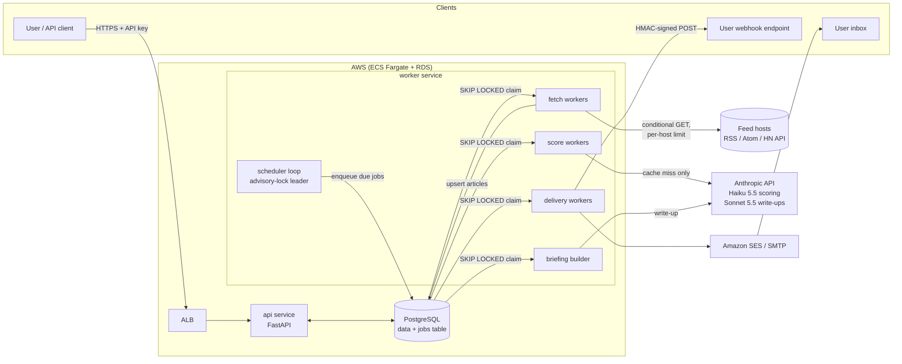
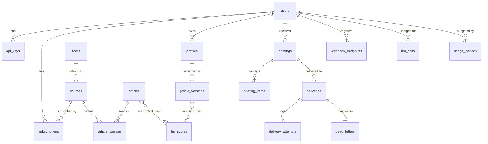

# briefing-engine: design plan

**Status:** draft for review. No code yet.
**Author:** Simon O'Connor
**Last updated:** 2026-11-08

This document comes before the code. Every section is a proposal: where a choice was made, the options and the reasoning are written down (see [Decision records](#15-decision-records)), and anything still undecided is listed under [Open questions](#16-open-questions).

---

## Contents

1. [Context](#1-context)
2. [Goals and non-goals](#2-goals-and-non-goals)
3. [Architecture overview](#3-architecture-overview)
4. [Data model](#4-data-model)
5. [REST API](#5-rest-api)
6. [Ingestion](#6-ingestion)
7. [LLM layer](#7-llm-layer)
8. [Delivery](#8-delivery)
9. [Job queue and worker](#9-job-queue-and-worker)
10. [Testing strategy](#10-testing-strategy)
11. [Deployment (AWS)](#11-deployment-aws)
12. [Observability](#12-observability)
13. [Case-study metrics](#13-case-study-metrics)
14. [Milestones](#14-milestones)
15. [Decision records](#15-decision-records)
16. [Open questions](#16-open-questions)

---

## 1. Context

Right now my daily AI briefing comes from [Horizon](https://github.com/Thysrael/Horizon), an open-source aggregator, run by a Windows scheduled task at 06:30 from `C:\dev\AI News`. It reads 14 RSS feeds plus the Hacker News top stories (score ≥ 100), scores items with `claude-sonnet-5-5` under two profiles (`ai-news` with threshold 6.0, `tech-blog` with threshold 5.0), extracts full text for some feeds with trafilatura, and sends the result over SMTP.

Getting it running took three upstream fixes (Thysrael/Horizon#220–#222). Each one points at a design requirement here:

| Horizon bug | What it teaches | Where this plan handles it |
|---|---|---|
| Anthropic rejected `temperature` ("Extra inputs are not permitted") and the fallback didn't recognise the error | Sampling parameters were removed from the API (on API version `2026-10-21` they 400 on every model). Don't send parameters the API doesn't need, and sort errors into kinds rather than matching message strings. | §7.2, §7.4 |
| Reddit RSS returned 429 when requests came in bursts | Rate-limit per host, honour `Retry-After`, and back off with jitter. Reddit's HTML and JSON routes return 403, so RSS is the only supported route. | §6.2, §6.3 |
| HTML in the email was escaped twice | Escape at exactly one layer, the template, and test it with golden files. | §8.1 |

Horizon is mostly configuration. This project is the replacement, written from scratch: a multi-user service that shows backend work (queues, idempotency, rate limiting, caching, cost control, signed webhooks, infrastructure as code) and is small enough that I can defend every line.

---

## 2. Goals and non-goals

### Goals

1. **Replace Horizon for my own briefing** (stage 1), delivered on time every day, with quality at least as good.
2. **Multi-user by design.** Sources and articles are shared. Rubrics, briefings, budgets and delivery settings belong to each user. Fetching and scoring scale with the number of distinct sources and rubrics, not with users × sources.
3. **Be polite to upstream hosts.** Per-host rate limits, `Retry-After`, conditional requests, an identifying User-Agent.
4. **Every step is idempotent.** Re-running any job, or a whole day, gives the same result, sends no duplicate email, and costs close to nothing.
5. **Cost is a visible, controlled quantity.** Every LLM call is recorded with its token counts and cost. Each user has a budget that can't be exceeded, even under concurrency.
6. **Measurable.** The system records the numbers the case study needs (§13) from day one.
7. **Deployable from scratch** with one `terraform apply` and a CI pipeline, with no hand-configured AWS resources.

### Non-goals

- **Web UI.** The interface is the REST API plus the email. OpenAPI docs come free with FastAPI.
- **Self-service sign-up, OAuth, social login.** Users are created by an admin CLI and authenticate with API keys.
- **Scraping that sites don't offer.** No headless browsers, no paywall workarounds, no Reddit HTML or JSON routes. Full-text extraction (as Horizon does with trafilatura) runs only for sources flagged for it, goes through the same per-host limiter, and is used only as LLM input. It is not republished.
- **Near-duplicate detection** (SimHash or MinHash for the same story under different wording). Exact deduplication by URL and content hash is in scope. Grouping articles about the same story is handed to the write-up model (§7.6), and proper clustering is future work.
- **Real-time or streaming delivery.** Briefings are batch: daily, or on demand through the API.
- **Multi-region, high availability or a production SLA.** Single region, single-AZ RDS. The plan notes where production would differ.
- **Recommendation ML or learning from clicks.** Scoring is rubric-driven and explainable.

---

## 3. Architecture overview

One Python codebase and one Docker image, run in two modes:

- **`api`**: FastAPI behind an ALB. Handles user-facing CRUD, briefing reads and on-demand triggers.
- **`worker`**: long-running job workers plus a scheduler loop, which only one worker runs at a time (a Postgres advisory lock decides which).

PostgreSQL is the system of record **and** the job queue. External dependencies are feed hosts, the Anthropic API, Amazon SES (or SMTP in stage 1) and user webhook endpoints.



### Pipeline for one day

```mermaid
sequenceDiagram
    autonumber
    participant S as Scheduler
    participant Q as jobs (Postgres)
    participant F as Fetch worker
    participant SC as Score worker
    participant B as Briefing builder
    participant D as Delivery worker

    S->>Q: enqueue fetch(source) for each due source (dedupe_key)
    Q->>F: claim
    F->>F: host slot? conditional GET → 304 or parse
    F->>Q: upsert articles; enqueue score(article, rubric) for each subscribed rubric on cache miss
    Q->>SC: claim (batched by rubric)
    SC->>SC: Haiku 5.5, structured output, validate → llm_scores
    S->>Q: at user's build time: enqueue build_briefing(user, date)
    Q->>B: claim
    B->>B: rank cached scores → Sonnet 5.5 write-up → briefings row
    B->>Q: enqueue deliver(briefing, channel) (unique per channel)
    Q->>D: claim → email / signed webhook, retries → dead_letters
```

### Code layout (proposed)

```
src/briefing_engine/
  api/            FastAPI routers, auth dependency, pagination, problem+json errors
  ingest/         fetcher, host limiter, retry policy, feed parsers, url/content normalisation
  llm/            client wrapper, prompts, schemas, scorer, writer, cache, cost/pricing, budgets
  delivery/       email renderer + sender, webhook signer + sender
  queue/          jobs table access, worker loop, leases, scheduler
  db/             SQLAlchemy Core tables, repositories, Alembic migrations
  observability/  logging config, metrics, health
  cli.py          admin + ops commands (create-user, run-daily, replay, import-horizon-config)
tests/
  unit/  integration/  e2e/  fixtures/
infra/            Terraform
```

---

## 4. Data model

PostgreSQL 17. Ids are `bigint generated always as identity` for internal tables and `uuid` (v7, so they sort by time) for ids that appear in the API. Times are `timestamptz` in UTC. Money is stored as **integer micro-dollars** (`bigint`, where 1 USD = 1,000,000) so there's no float rounding in budgets.

### 4.1 Entity overview



### 4.2 Tables

**Identity and auth**

| Table | Key columns | Constraints / indexes |
|---|---|---|
| `users` | `id uuid`, `email citext`, `display_name`, `timezone text` (IANA), `send_time time` (local), `monthly_budget_micros bigint`, `created_at`, `disabled_at` | `UNIQUE(email)` |
| `api_keys` | `id uuid`, `user_id`, `prefix char(12)`, `secret_hash bytea` (SHA-256), `name`, `scopes text[]`, `created_at`, `last_used_at`, `expires_at`, `revoked_at` | `UNIQUE(prefix)`; `INDEX(user_id)`. Lookup is by prefix, then a constant-time compare of the hash. |

**Sources and ingestion**

| Table | Key columns | Constraints / indexes |
|---|---|---|
| `hosts` | `host text PK`, `min_interval_ms int` (default 2000), `next_allowed_at timestamptz`, `blocked_until timestamptz` (from `Retry-After`), `notes` | One row per host. This is the shared state the per-host limiter works from (§6.2). |
| `sources` | `id`, `kind` (`rss`, `atom`, `hn_top`), `url`, `url_normalised`, `host` FK, `extract_full_text bool`, `etag`, `last_modified`, `last_body_sha256`, `fetch_interval interval`, `next_fetch_at`, `consecutive_failures int`, `status` (`active`, `paused`, `broken`) | `UNIQUE(url_normalised)`, so users who add the same feed share one source. Partial index `(next_fetch_at) WHERE status = 'active'`. |
| `subscriptions` | `user_id`, `source_id`, `profile_id`, `weight real default 1.0`, `created_at` | `PRIMARY KEY(user_id, source_id)` |
| `fetch_log` | `id`, `source_id`, `started_at`, `attempt`, `status_code`, `conditional_sent bool`, `outcome` (`ok`, `not_modified`, `unchanged_body`, `retryable_error`, `fatal_error`, `rate_limited`), `retry_after_s`, `bytes`, `duration_ms`, `error` | `INDEX(source_id, started_at DESC)`; 30-day retention. Raw data for the metrics in §13. |

**Articles and deduplication**

| Table | Key columns | Constraints / indexes |
|---|---|---|
| `articles` | `id`, `url_canonical`, `url_hash bytea` (SHA-256 of the normalised URL), `content_hash bytea`, `duplicate_of bigint NULL`, `title`, `author`, `published_at`, `first_seen_at`, `last_seen_at`, `summary_text` (from the feed), `body_text` (extracted, truncated to 20k characters), `hn_points int NULL`, `hn_comments_url` | `UNIQUE(url_hash)`; `INDEX(content_hash)`; `INDEX(first_seen_at)`; partial `INDEX(duplicate_of) WHERE duplicate_of IS NOT NULL` |
| `article_sources` | `article_id`, `source_id`, `first_seen_at` | `PRIMARY KEY(article_id, source_id)`. Records "seen in 3 feeds", which feeds into ranking. |

The deduplication rules (detail in §6.5):

1. **Same normalised URL means the same article.** This is enforced by `UNIQUE(url_hash)` and `INSERT … ON CONFLICT (url_hash) DO UPDATE SET last_seen_at = now()`.
2. **Same content hash at a different URL means a syndicated copy.** The new row is kept for provenance, but `duplicate_of` points at the earliest article with that hash (looked up within 14 days). It is never scored separately and never appears twice in a briefing.
3. **Same URL with new content** (an edited article): `content_hash` is updated in place. Scores are keyed by content hash, so the article is re-scored only if it's still inside the briefing window.

**Profiles and rubrics**

| Table | Key columns | Constraints / indexes |
|---|---|---|
| `profiles` | `id uuid`, `user_id`, `name` (for example `ai-news`), `current_version int`, `threshold real`, `max_items int` | `UNIQUE(user_id, name)` |
| `profile_versions` | `profile_id`, `version int`, `rubric jsonb`, `rubric_hash bytea`, `created_at` | `PRIMARY KEY(profile_id, version)`. Rows are never changed: editing a rubric inserts a new version. `rubric_hash` is SHA-256 of the canonical JSON of the rubric (sorted keys, no whitespace). |

**LLM cache, ledger and budgets**

| Table | Key columns | Constraints / indexes |
|---|---|---|
| `llm_scores` | `content_hash`, `rubric_hash`, `model`, `prompt_version`, `score smallint` (0–10), `reason text`, `topics text[]`, `method` (`llm`, `llm_retry`), `llm_call_id`, `created_at` | `PRIMARY KEY(content_hash, rubric_hash, model, prompt_version)`. This **is** the score cache (§7.3). Only valid scores are stored. Failures are never cached. |
| `llm_writeups` | `cache_key bytea PK` (hash of the sorted content hashes, rubric hash, model and prompt version), `output jsonb`, `llm_call_id`, `created_at` | A write-up cache, so re-running a day is free. |
| `llm_calls` | `id`, `user_id NULL` (null means shared work), `purpose` (`score`, `writeup`, `enrich`), `model`, `request_id`, `input_tokens`, `output_tokens`, `cache_read_tokens`, `cache_write_tokens`, `cost_micros`, `latency_ms`, `outcome` (`ok`, `invalid_output`, `refusal`, `max_tokens`, `api_error`), `created_at` | `INDEX(user_id, created_at)`. One row per API call: the cost ledger. |
| `llm_cache_hits` | `user_id`, `purpose`, `saved_cost_micros`, `created_at` | Append-only; can be rolled up by day. Records what each cache hit *would have* cost, which gives the "before caching" number in §13. |
| `usage_periods` | `user_id`, `period_start date` (first of the month), `limit_micros`, `reserved_micros`, `spent_micros` | `PRIMARY KEY(user_id, period_start)`; `CHECK (reserved_micros >= 0 AND spent_micros >= 0)`. The budget-enforcement row (§7.7). |

**Briefings and delivery**

| Table | Key columns | Constraints / indexes |
|---|---|---|
| `briefings` | `id uuid`, `user_id`, `profile_id`, `profile_version`, `briefing_date date` (the user's local date), `status` (`building`, `ready`, `degraded`, `failed`), `writeup jsonb`, `cost_micros`, `created_at`, `ready_at` | `UNIQUE(user_id, profile_id, briefing_date)`. This is what makes re-runs idempotent. |
| `briefing_items` | `briefing_id`, `article_id`, `rank smallint`, `score smallint`, `blurb text`, `group_key text NULL` | `PRIMARY KEY(briefing_id, article_id)`; `UNIQUE(briefing_id, rank)` |
| `webhook_endpoints` | `id uuid`, `user_id`, `url`, `secret_ciphertext bytea` (current), `previous_secret_ciphertext bytea NULL`, `previous_secret_expires_at`, `event_types text[]`, `status` (`active`, `disabled`), `consecutive_dead int`, `created_at` | `INDEX(user_id)` |
| `deliveries` | `id uuid` (also the webhook event id), `briefing_id`, `channel` (`email`, `webhook`), `endpoint_id NULL`, `status` (`pending`, `in_flight`, `succeeded`, `dead`), `attempts int`, `next_attempt_at`, `last_error` | `UNIQUE NULLS NOT DISTINCT (briefing_id, channel, endpoint_id)`: at most one delivery per briefing per destination. |
| `delivery_attempts` | `delivery_id`, `attempt int`, `started_at`, `status_code`, `duration_ms`, `error`, `response_excerpt` (first 512 bytes) | `PRIMARY KEY(delivery_id, attempt)` |
| `dead_letters` | `id`, `kind` (`delivery`, `job`), `ref_id`, `payload jsonb`, `last_error`, `failed_at`, `replayed_at NULL` | `INDEX(failed_at) WHERE replayed_at IS NULL` |

**Queue** (detail in §9)

| Table | Key columns | Constraints / indexes |
|---|---|---|
| `jobs` | `id bigint`, `queue text` (`fetch`, `score`, `build`, `deliver`, `maintenance`), `kind`, `payload jsonb`, `dedupe_key text NULL`, `state` (`queued`, `running`, `succeeded`, `failed`, `dead`), `priority smallint`, `run_at`, `attempts`, `max_attempts`, `locked_by`, `lease_expires_at`, `last_error`, `created_at`, `finished_at` | Partial `UNIQUE(dedupe_key) WHERE state IN ('queued', 'running')`; partial `INDEX(queue, priority DESC, run_at) WHERE state = 'queued'`; partial `INDEX(lease_expires_at) WHERE state = 'running'` |
| `workers` | `id text PK`, `started_at`, `last_heartbeat_at`, `version` | Used for health checks and for alerting on stuck workers. |

### 4.3 Migrations

Alembic, forward-only once the database is deployed. Schema changes that would break a running version use expand/contract: add the new column and backfill, deploy code that uses it, then drop the old one in a later migration. CI applies every migration to an empty database, and checks that the tables Alembic generates match the ones the code defines.

---

## 5. REST API

### 5.1 Conventions

- Base path `/v1`, JSON only, UTF-8.
- **Auth:** `Authorization: Bearer <key>`. See §5.3.
- **Errors:** RFC 9457 `application/problem+json` with `type`, `title`, `status`, `detail` and a `request_id`. Validation errors list each failing field.
- **Request ids:** an `X-Request-Id` header is accepted, or generated, and echoed back. It appears in every log line.
- **Idempotency:** `POST` requests that create work (`/briefings`, `/deliveries/{id}/replay`) accept an `Idempotency-Key` header. The key and a hash of the request are stored for 24 hours. A retry with the same key returns the original response. The same key with a different body returns `422`.
- **API rate limits** (stage 3): per-key token bucket. Over the limit returns `429` with `Retry-After`, plus `RateLimit-Limit`, `RateLimit-Remaining` and `RateLimit-Reset` headers. The service gives clients the same courtesy it expects from feed hosts.
- **Versioning:** additive changes stay in `/v1`. Breaking changes get a `/v2` router served alongside it.

### 5.2 Resources and endpoints

| Method and path | Purpose | Notes |
|---|---|---|
| `GET /v1/me` | The current user, their budget and their send time | |
| `PATCH /v1/me` | Update timezone, send time and display name | Validates the IANA timezone name |
| `GET /v1/api-keys` | List keys (prefix, name, last used) | The secret is never returned |
| `POST /v1/api-keys` | Create a key | The **only** response that contains the full secret |
| `DELETE /v1/api-keys/{id}` | Revoke a key | Soft revoke (`revoked_at`), takes effect immediately |
| `GET /v1/subscriptions` | My feeds | Paginated |
| `POST /v1/subscriptions` | `{url, kind?, profile, weight?}`: subscribe | Normalises the URL, runs the SSRF guard, finds or creates the shared `source`, and answers `201` or `200` if already subscribed |
| `DELETE /v1/subscriptions/{id}` | Unsubscribe | A source with no subscribers is paused, not deleted |
| `GET /v1/profiles` / `POST /v1/profiles` | List or create rubric profiles | |
| `GET /v1/profiles/{id}` | Current version, threshold, max items | |
| `PUT /v1/profiles/{id}/rubric` | Replace the rubric, which **creates a new version** | Returns the new version number. Old scores stay cached under the old rubric hash. |
| `GET /v1/profiles/{id}/versions` | Version history | |
| `GET /v1/articles` | Scored articles for me. Filters: `profile`, `since`, `min_score`, `source_id` | Keyset pagination on `(first_seen_at DESC, id DESC)` |
| `GET /v1/briefings` | My briefings | Keyset on `(briefing_date DESC, id DESC)` |
| `GET /v1/briefings/{id}` | One briefing with its items | `id` may also be `YYYY-MM-DD?profile=ai-news` |
| `POST /v1/briefings` | Build one now: `{profile, date?}` | `202` with a `job_id`. Idempotent per (user, profile, date). |
| `GET /v1/jobs/{id}` | Job status (my jobs only) | |
| `GET /v1/webhook-endpoints` / `POST` | List or register endpoints | `POST` returns the signing secret once. SSRF guard; HTTPS required in production. |
| `DELETE /v1/webhook-endpoints/{id}` | Remove an endpoint | |
| `POST /v1/webhook-endpoints/{id}/rotate-secret` | New secret. The old one keeps working for 24 hours. | During the overlap, both signatures are sent |
| `POST /v1/webhook-endpoints/{id}/test` | Send a signed `ping` event | |
| `GET /v1/deliveries` | Filter by `status`, `channel` | Shows failures and dead letters |
| `POST /v1/deliveries/{id}/replay` | Re-send a dead delivery | Idempotency-Key supported |
| `GET /v1/usage` | `period=2026-11`: tokens and cost by purpose and model, budget left, cache savings | |
| `GET /healthz` / `GET /readyz` | Liveness and readiness | No auth. See §12.3. |

Admin actions (create a user, set a budget, pause a source) are **CLI commands that run against the database**, not HTTP endpoints. That keeps admin permissions out of the public API.

### 5.3 Per-user API keys

- **Format:** `bek_<12-char prefix>_<32 random bytes, base62>`. The `bek_` marker lets secret scanners (GitHub push protection, trufflehog) recognise the key and makes leaks easy to grep for. The prefix is a non-secret lookup id.
- **Storage:** the secret is stored as `SHA-256(secret)`, not bcrypt or argon2. The secret has 256 bits of entropy, so a fast hash can't be brute-forced, and it keeps auth to well under a millisecond (ADR-004). The comparison uses `hmac.compare_digest`.
- **Lookup:** parse the prefix, `SELECT … WHERE prefix = $1 AND revoked_at IS NULL AND (expires_at IS NULL OR expires_at > now())`, then compare the hash. Missing key, wrong secret and revoked key all return the same `401`.
- **`last_used_at`:** written at most once a minute per key, so authenticated reads don't each cause a write.
- **Scopes:** `read` and `write` in stage 2. They're enough to hand a read-only key to a dashboard.
- **Never logged.** The logging layer redacts `Authorization` headers and anything matching `bek_`.

### 5.4 Pagination

Keyset (cursor) pagination, not offset:

```
GET /v1/articles?limit=50&cursor=eyJ0IjoiMjAyNi0xMS0wOFQwNjozMDowMFoiLCJpZCI6MTIzNDV9
→ { "data": [...], "next_cursor": "…" | null }
```

- The cursor is opaque: base64url of `{sort key, id}`, signed with HMAC so clients can't tamper with it or depend on its contents.
- `limit` defaults to 50, maximum 200.
- The query is `WHERE (first_seen_at, id) < ($t, $id) ORDER BY first_seen_at DESC, id DESC LIMIT $n + 1`. Fetching one extra row tells us whether there's a next page without a `COUNT(*)`.
- **Why:** pages stay stable while new articles are inserted (offset pagination skips or repeats rows), and the cost is constant at any depth because it uses an index. ADR-008.

---

## 6. Ingestion

### 6.1 Flow

1. The **scheduler** (each minute) selects sources where `status = 'active' AND next_fetch_at <= now()` and enqueues `fetch(source_id)` with `dedupe_key = 'fetch:{source_id}'`. The partial unique index means a source can't have two fetch jobs at once.
2. The **fetch worker** acquires a host slot (§6.2), sends a conditional GET (§6.4), and classifies the result (§6.3).
3. On `200`, it parses the feed with `feedparser` (the HN API uses its own adapter), normalises each entry (§6.5), and upserts `articles` and `article_sources`.
4. For each new or changed article, it finds the rubrics of subscribers to this source and enqueues scoring for any (content_hash, rubric_hash) not already in `llm_scores`. The enqueue happens **in the same transaction** as the article upsert (§9.1).
5. If `extract_full_text` is set, it enqueues `extract(article_id)` on the same host limiter. trafilatura runs on the fetched page, and `body_text` is truncated to 20k characters.
6. It sets `next_fetch_at = now() + fetch_interval`. The interval adapts: after 5 unchanged fetches it doubles, up to 6 hours. Any change resets it to the source's base interval, 30 minutes by default.

HTTP client: `httpx` with a 5 s connect timeout and 20 s read timeout, at most 5 redirects, and a 5 MB response cap read as a stream (larger responses are aborted). The User-Agent is `briefing-engine/<version> (+https://github.com/simonoconnordev/briefing-engine)`. It identifies the service and gives a contact URL, and never a personal email address.

**SSRF guard** (needed once users submit URLs in stage 2): resolve the hostname, reject loopback, private (RFC 1918), link-local (including `169.254.169.254`, the AWS instance metadata service), CGNAT, multicast and IPv6 unique-local addresses. Check again on **every redirect hop**. Connect to the IP that was validated, so a DNS rebinding trick can't swap it after the check. Webhook URLs go through the same guard.

### 6.2 Per-host rate limiting

Workers run as several processes and tasks, so the limit is enforced in **Postgres**, not in memory. One row in `hosts` holds the next free slot:

```sql
UPDATE hosts
SET next_allowed_at = GREATEST(now(), next_allowed_at, COALESCE(blocked_until, now()))
                      + make_interval(secs => min_interval_ms / 1000.0)
WHERE host = $1
RETURNING next_allowed_at - make_interval(secs => min_interval_ms / 1000.0) AS my_slot;
```

- If `my_slot <= now()`, fetch now.
- If `my_slot` is in the future, **don't sleep while holding the job.** Set the job's `run_at = my_slot` and release it. A worker never blocks on a slow host while other hosts are waiting.
- The row lock lasts as long as one `UPDATE`, so contention stays small.
- Defaults: 2 s between requests per host. Overrides are seeded per host. `www.reddit.com` gets 10 s, because both Horizon subreddit feeds hit it in the same minute, and that was the 429 burst.
- `blocked_until` is set from `Retry-After` (§6.3), so **every** source on that host waits, not only the one that got the 429.

Trade-off: a Postgres round-trip per fetch costs about 1 ms. At hundreds of fetches a minute that's nothing, and it saves running Redis. ADR-001 covers the general "Postgres first" choice.

### 6.3 Retries, backoff and `Retry-After`

**Classification** (one table in code, unit-tested):

| Result | Class | Action |
|---|---|---|
| `200` | ok | Parse |
| `304` | not modified | Record, don't parse |
| `429`, `503` with `Retry-After` | rate limited | Honour `Retry-After` and set `hosts.blocked_until` |
| `408`, `425`, `429`/`5xx` without a header, connection reset, timeout, DNS failure | retryable | Exponential backoff |
| `301`, `308` | permanent redirect | Update `sources.url` after the SSRF check, record the change |
| `401`, `403`, `404` | fatal for this run | `consecutive_failures++`. After 5 the source is marked `broken`. No retries within the run. |
| `410 Gone` | fatal, permanent | Mark `broken` immediately |
| Parse error, or more than 5 MB | fatal for this run | Record, count as a failure |

**`Retry-After` parsing** accepts both forms in RFC 9110: delta-seconds (`120`) and HTTP-date (`Wed, 21 Oct 2026 07:28:00 GMT`). Values are clamped to the range [1 s, 6 h]. Values that are negative, can't be parsed or are in the past fall back to normal backoff. Anything over the clamp means the source skips the run and is logged as `rate_limited`.

**Backoff:** "full jitter", `delay = random(0, min(cap, base × 2^attempt))` with `base = 2 s`, `cap = 5 min`, at most 4 attempts per fetch cycle. When `Retry-After` is present it is the **minimum** delay and jitter is added on top, so clients that were all told the same second don't come back at once.

**Retries are rescheduled jobs**, not `sleep()` inside the worker: `attempts++`, `run_at = now() + delay`, release. A worker is never tied up for minutes, and a crash between attempts loses nothing.

### 6.4 Conditional requests (ETag and Last-Modified)

- On every `200`, store the `ETag` (strong or weak, kept exactly as sent) and `Last-Modified` from the response.
- On the next fetch, send `If-None-Match: <etag>` and `If-Modified-Since: <last_modified>`. Validators are **only** updated from a `200`, never from a `304`.
- `304` means nothing to parse or score. Logged as `not_modified`.
- **Soft 304:** many feeds ignore validators. We keep `last_body_sha256`, and if a `200` body hashes the same as last time we skip parsing and log `unchanged_body`. §13 reports it separately from real `304`s, since it saves CPU and LLM work but not bandwidth.
- If a server returns `304` when we sent no validators (a broken server), treat it as a `200` with an empty body and log a warning.

### 6.5 Normalisation and deduplication

**URL normalisation** (a pure function, tested with tables and property tests):

1. Parse, lowercase the scheme and host, convert IDNA to punycode, drop the default port (`:80`, `:443`), drop the `#fragment`.
2. Upgrade `http` to `https` **only for hosts on a known-HTTPS allowlist**. Upgrading blindly can merge different resources.
3. Remove tracking parameters: `utm_*`, `fbclid`, `gclid`, `mc_cid`, `mc_eid`, `ref`, `ref_src`, `igshid`, `si`, and Substack's `r` and `s`. The list is kept in config.
4. Sort the remaining query parameters and keep empty values as they are.
5. Remove dot-segments in the path. A trailing slash is **kept** (it can mean a different resource), except on the root path.
6. Hacker News items: use the **target URL** as the article and store the HN discussion URL as metadata. "Ask HN" posts with no target URL use the HN item URL.

`url_hash = sha256(normalised_url)`. Property tests check `normalise(normalise(x)) == normalise(x)`.

**Content hash:** `sha256(NFKC(lowercase(collapse_whitespace(strip_html(title + "\n" + (body_text or summary_text))))))`. Boilerplate the extractor adds is removed first. This catches syndicated copies (the same press release on five sites) and feeds that republish an item under a new GUID.

**Dedup on insert,** in one transaction per feed:

```sql
INSERT INTO articles (url_hash, url_canonical, content_hash, title, …)
VALUES (…)
ON CONFLICT (url_hash) DO UPDATE
   SET last_seen_at = now(),
       content_hash = EXCLUDED.content_hash,          -- edited article
       title        = EXCLUDED.title
RETURNING id, (xmax = 0) AS inserted, content_hash;
```

Then, for rows that were just inserted: `UPDATE articles SET duplicate_of = (SELECT min(id) FROM articles WHERE content_hash = $h AND id <> $id AND first_seen_at > now() - interval '14 days') WHERE id = $id`. Finally `INSERT … ON CONFLICT DO NOTHING` into `article_sources`.

### 6.6 Safe re-runs

Every stage can be re-run, and repeating it changes nothing:

| Stage | What makes it idempotent |
|---|---|
| Enqueue | `dedupe_key` plus a partial unique index. Re-enqueueing a queued or running job is a no-op (`ON CONFLICT DO NOTHING`). |
| Fetch | Upserts keyed by `url_hash`. Conditional GET means a re-fetch usually transfers nothing. |
| Score | Cache lookup first, by `(content_hash, rubric_hash, model, prompt_version)`, then `INSERT … ON CONFLICT DO NOTHING`. If two workers race, one call may be wasted but the stored result is the same. |
| Build | `UNIQUE(user_id, profile_id, briefing_date)`. Re-building a `ready` briefing returns it unchanged unless `--force` is passed. The write-up cache makes even a forced rebuild free. |
| Deliver | `UNIQUE(briefing_id, channel, endpoint_id)` plus a state machine (§8.3). |

`briefing run-daily --date 2026-11-09` runs the whole pipeline for a date. Run twice, the second run should cost about $0 and send nothing. That's a stage 1 acceptance test.

---

## 7. LLM layer

### 7.1 Responsibilities and models

| Task | Model | Why |
|---|---|---|
| **Scoring** articles against a rubric (high volume, short output) | `claude-haiku-5-5` | Cheapest tier ($0.10 / $0.50 per million input / output tokens for prompts up to 100K). The task is classification plus a one-line reason, which Haiku handles well. |
| **Write-up** of the top N items (once per briefing, the part the reader actually sees) | `claude-sonnet-5-5` | Better prose and judgment about grouping related stories ($2 / $10 per million tokens). It runs once a day per user, so the price difference hardly matters. |

All model ids and prices live in **one config table** (`pricing.toml`: model → input, output, cache-read and cache-write prices, effective date). Prices are as of the 2026-10 Anthropic price list, **to be checked again when this is implemented**. `llm_calls.cost_micros` is calculated at call time and stored, so a later price change doesn't rewrite history.

Measuring before committing: the stage 1 shadow week (§14) includes an evaluation. Score 200 real articles with Haiku 5.5 and with Sonnet 5.5, and compare rank agreement (Spearman) and the top-10 overlap against my own labels. If Haiku's top 10 is clearly worse, the fallback options are Haiku at higher `effort`, or Sonnet at low `effort` for scoring. The case study reports whichever wins, with the numbers.

### 7.2 Calling the API

- Official `anthropic` Python SDK. One thin wrapper (`llm/client.py`) is the only place the SDK is imported. Everything else depends on a `Scorer` / `Writer` interface, so tests can substitute fakes.
- **No sampling parameters** (`temperature`, `top_p`, `top_k`). They return a 400 on current models and API versions, which was Horizon bug #1. Consistent output comes from structured outputs and the cache, not from temperature.
- `output_config.effort` is set explicitly on every call (`low` for scoring, `medium` for write-ups), because the default effort differs between models.
- Errors are classified by **SDK exception type and status code**, never by message text: `RateLimitError` and `5xx`/`529` are retryable with backoff and honour `retry-after`; `BadRequestError` is a fatal bug that pages me; `AuthenticationError` is fatal for everything.
- The SDK's own retries are turned off (`max_retries=0`). Retries go through our job queue, so backoff, attempts and cost are all visible in one place.
- Untrusted content: article text is **data**, sent inside clearly delimited blocks, and the system prompt says to treat it only as material to score. The model gets **no tools**, and its output is limited to a schema of numbers and short strings that are escaped on render. So prompt injection in an article can at worst skew that article's own score.

### 7.3 Scoring with structured output

**Rubric** (`profile_versions.rubric`, validated by a Pydantic model):

```json
{
  "description": "AI engineering news for a backend engineer who builds API integrations",
  "interests": [
    {"topic": "new model releases and API changes", "weight": 3},
    {"topic": "agent frameworks and tool use in production", "weight": 2},
    {"topic": "evals, cost and latency engineering", "weight": 2}
  ],
  "avoid": ["funding rounds without technical content", "opinion pieces with no new information"],
  "scale_hint": "10 = must read today, 6 = worth a skim, 0 = irrelevant"
}
```

**Request shape:** articles are scored **in batches of 10 per call**, all under the same rubric. The system prompt holds the instructions and the rubric, marked with `cache_control` so batches 2 onwards read the rubric from Anthropic's prompt cache. (Prompts below the model's minimum cacheable size simply aren't cached. The stage 1 measurements will show whether the rubric prefix is long enough.) Each article is sent as `{ref: "a3", title, source, published_at, text: first 1,500 tokens}`.

**Output schema**, enforced with `output_config.format` (JSON schema) and parsed into Pydantic with `client.messages.parse()`:

```json
{
  "type": "object",
  "additionalProperties": false,
  "required": ["items"],
  "properties": {
    "items": {
      "type": "array",
      "items": {
        "type": "object",
        "additionalProperties": false,
        "required": ["ref", "score", "reason", "topics"],
        "properties": {
          "ref":    {"type": "string"},
          "score":  {"type": "integer", "minimum": 0, "maximum": 10},
          "reason": {"type": "string", "maxLength": 240},
          "topics": {"type": "array", "items": {"type": "string"}, "maxItems": 5}
        }
      }
    }
  }
}
```

**Checks beyond the schema** (structured outputs guarantee the shape, not the meaning): every `ref` sent comes back exactly once, there are no unknown refs, and the score is in range (checked again even though the schema enforces it). Any failure is a validation failure.

### 7.4 Fallbacks for bad output

Each step is tried in order, and each is recorded in `llm_calls.outcome`:

1. `stop_reason == "max_tokens"` → retry the batch with a higher `max_tokens`, once.
2. `stop_reason == "refusal"` (Haiku 5.5 has no server-side fallback) → **split the batch in half** and retry each half. That isolates the one article that triggered it.
3. Schema or meaning validation fails → split and retry, down to a batch of 1.
4. A single article still fails → it gets **no score**. `briefing_items` skips it, and the briefing footer lists it as "not scored" with a link, so nothing disappears silently. **Failures are not cached.** The next run tries again.
5. API unavailable (`5xx`/`529`/timeouts after the job's retries are exhausted) → the build waits until the user's send time minus 10 minutes, then sends a **degraded** briefing: articles ranked by a heuristic (source weight × recency × HN points), with a banner saying LLM scoring was unavailable. On time with less, rather than late.

Partial success is kept: if 9 of 10 refs are valid, the 9 are stored and only the missing one is retried.

### 7.5 Score cache

- **Key:** `(content_hash, rubric_hash, model, prompt_version)`.
  - `content_hash`, not article id, so syndicated duplicates and re-fetched articles hit the cache.
  - `rubric_hash`, not `(profile_id, version)`, so a rubric that's reverted, or **two users with identical rubrics** (for example a shared "AI news" preset), share scores. That's the stage 3 shared cache, and it needs no extra mechanism (ADR-005). Users never see each other's data: a hit only happens when the rubric text is identical, and only the score and reason are reused.
  - `model` and `prompt_version` (a constant in code, bumped whenever the prompt template changes) mean changing either invalidates the cache cleanly, with no flush.
- **Lookup** before enqueueing (§6.1 step 4) and again before calling the API (another worker may have filled it). Only misses reach the API.
- **Hits are recorded** in `llm_cache_hits` with the cost the call would have had, which gives the "before caching" figure without having to switch caching off in production.
- No expiry: articles older than 14 days aren't scored again anyway. Old rows are pruned after 90 days.

### 7.6 Write-ups

- Input: the top `max_items` (default 12) articles above the profile threshold, ranked by `score × source weight × log(1 + number of sources carrying it)`, plus the rubric description.
- Output, again structured JSON: `{headline, intro (≤ 80 words), items: [{ref, blurb (≤ 60 words), group_key?}]}`. `group_key` lets Sonnet mark items about the same story, which brings back the useful part of Horizon's `topic_dedup` without near-duplicate machinery. The renderer groups them under one heading.
- **The model returns text, never HTML.** All markup comes from our templates (§8.1).
- Cached in `llm_writeups`, keyed by the sorted content hashes of the items, the rubric hash, the model and the prompt version.
- Sonnet 5.5 refusals: use the API's server-side `fallbacks` option (Claude API only). If the write-up still fails, the briefing goes out as `degraded`, with the Haiku `reason` strings standing in for blurbs.

### 7.7 Per-user token budgets and cost tracking

- **Ledger:** one `llm_calls` row per API call, with real token counts from `response.usage` (input, output, cache read, cache write) and `cost_micros` from the price table.
- **Who pays for shared work:** the user whose job caused the cache miss is charged. Later users who hit the cache are charged nothing, and their `llm_cache_hits` row records the saving. (Alternative: split the cost across everyone subscribed. That's fairer, but harder to explain and to audit. Open question Q7.)
- **Enforcement with reservations**, so concurrent jobs can't overspend:

  ```sql
  -- before the call: reserve an estimate (upper bound from token count × price)
  UPDATE usage_periods
  SET reserved_micros = reserved_micros + $est
  WHERE user_id = $u AND period_start = $p
    AND spent_micros + reserved_micros + $est <= limit_micros
  RETURNING 1;                      -- no row → budget exhausted
  -- after the call (same row): settle
  UPDATE usage_periods
  SET reserved_micros = reserved_micros - $est,
      spent_micros    = spent_micros + $actual
  WHERE user_id = $u AND period_start = $p;
  ```

  The estimate is `input tokens (counted, or chars ÷ 3.5) × input price + max_tokens × output price`, which is never lower than the real cost. The settle step goes in the same transaction as the `llm_calls` insert. A reaper releases reservations older than 15 minutes, which covers a worker crashing mid-call.
- **Degrading when the budget runs out**, in order: (1) skip the Sonnet write-up and send the ranked list with Haiku reasons; (2) score only the top 30 candidates by heuristic; (3) send a heuristic-only briefing. It never goes over budget and never sends nothing. `GET /v1/usage` and the email footer show the budget state.
- **Expected cost** (to be checked in stage 1), assuming about 300 new articles a day across the 15 Horizon sources:
  - Scoring: 300 × ~450 input tokens + 30 batches × ~1.2K rubric tokens (mostly cache reads after the first) ≈ 150K input tokens ≈ $0.015; output 300 × ~60 tokens = 18K ≈ $0.009.
  - Write-up: about 8K input and 1.5K output on Sonnet ≈ $0.016 + $0.015.
  - **Total ≈ $0.05–0.06 per briefing.** The write-up, not the scoring, is the larger share. That's a finding the case study can confirm or correct. Horizon currently scores everything with Sonnet, which this design should undercut by roughly 10×. The shadow week will measure it.
- **Batch API option:** Anthropic's Message Batches API charges 50% less and isn't latency-sensitive, which suits overnight scoring. The cost is up to 24 hours' turnaround (usually much faster). That's acceptable for sources fetched in the evening, but not for items fetched at 06:00. Proposal: use it in stage 3 for scoring that isn't urgent, and measure the saving. Open question Q9.

---

## 8. Delivery

### 8.1 Email: escaped exactly once

The rule: **data stays raw until the template layer, and only the template escapes.**

- Article titles, feed summaries and model text are stored and passed around **unescaped** (feed HTML entities are decoded once, at parse time, into plain text).
- Templates are Jinja2 with `autoescape=True`. No `|safe` filter on any field that came from a feed or a model, which CI enforces with a grep-based lint.
- URLs in `href` are checked for an `http`/`https` scheme (anything else, including `javascript:`, is dropped) and then attribute-escaped by the template.
- Each email has a plain-text part as well (`multipart/alternative`), built from the same data.
- **Golden tests:** fixtures with titles like `AT&T <script>alert(1)</script> "quotes" & 'apostrophes'` and already-escaped feed text (`&amp;amp;`). The expected HTML is stored as a golden file. The test fails on double escaping (`&amp;amp;`) and on missing escaping (a raw `<script>`). This is the regression test for Horizon bug #3.
- Sending: **stage 1** uses SMTP with the credentials Horizon uses today, read from `.env` (Q3). **Stage 2** uses Amazon SES with a verified domain, DKIM, and a `List-Unsubscribe` header.

### 8.2 Signed webhooks

The event payload, `POST`ed as JSON:

```json
{
  "id": "0193f4b2-…",            // = deliveries.id, stable across retries
  "type": "briefing.ready",
  "created_at": "2026-11-09T06:30:02Z",
  "data": { "briefing_id": "…", "date": "2026-11-09", "profile": "ai-news",
            "url": "https://api…/v1/briefings/…", "items": [ … ] }
}
```

The signature follows the [Standard Webhooks](https://www.standardwebhooks.com/) scheme, so consumers can verify it with existing libraries:

- Headers: `webhook-id`, `webhook-timestamp` (Unix seconds), and `webhook-signature: v1,<base64(HMAC-SHA256(secret, "{id}.{timestamp}.{raw_body}"))>`.
- During a secret rotation, both signatures are sent, separated by a space. Consumers accept either.
- Consumers should reject timestamps more than 5 minutes off (to block replays) and de-duplicate on `webhook-id`, because delivery is at-least-once. The docs include a 15-line Python verifier, and a test checks that it agrees with our signer.
- Secrets: 32 random bytes, shown once. They are stored **encrypted** (Fernet, with a key from AWS Secrets Manager), not hashed, because we need the plaintext to sign.
- The SSRF guard applies, HTTPS is required in production, timeout is 10 s, redirects are not followed, and only the first 512 bytes of a response are read.

### 8.3 Retries and the dead-letter table

The delivery state machine: `pending → in_flight → succeeded`, or `in_flight → pending` (a retry is scheduled), or `in_flight → dead`.

| Response | Action |
|---|---|
| `2xx` | `succeeded` |
| `410 Gone` | `dead` immediately, endpoint `disabled` |
| `429` / `503` with `Retry-After` | Retry at `max(Retry-After, the next backoff step)` |
| Other `4xx`, `5xx`, timeout, connection error | Retry |

- Schedule (with ±20% jitter): 1 min, 5 min, 30 min, 2 h, 6 h, 12 h. That's 7 attempts over about 21 hours, which outlasts an overnight outage at the receiver.
- After the last attempt: `status = 'dead'`, plus a `dead_letters` row holding the exact payload. `POST /v1/deliveries/{id}/replay` sends it again with the **same** event id, freshly signed.
- After 3 consecutive dead deliveries the endpoint is set to `disabled`, and the user gets an email saying so.
- Email uses the same state machine, but SMTP and SES errors are classified differently. Permanent rejections (5xx SMTP, SES `MessageRejected`) go straight to dead.

**Exactly-once isn't possible** across a network boundary. If the worker crashes after the receiver accepted a request but before we record `succeeded`, the lease expires and the delivery is retried. We keep that window small (the state is recorded straight after the response) and make retries harmless (a stable `webhook-id`). For email, the same crash can cause a rare duplicate. The trade-off is documented rather than hidden.

---

## 9. Job queue and worker

### 9.1 Postgres-backed queue

**Claiming** (each worker loop):

```sql
WITH next AS (
  SELECT id FROM jobs
  WHERE state = 'queued' AND queue = ANY($queues) AND run_at <= now()
  ORDER BY priority DESC, run_at
  LIMIT $batch
  FOR UPDATE SKIP LOCKED
)
UPDATE jobs j
SET state = 'running', attempts = attempts + 1,
    locked_by = $worker_id, lease_expires_at = now() + $lease
FROM next WHERE j.id = next.id
RETURNING j.*;
```

- **`SKIP LOCKED`:** workers running at once never block each other or claim the same job.
- **Leases, not long transactions:** the claim commits straight away. The job runs outside any transaction, and a heartbeat extends `lease_expires_at` every `lease / 3`. A **reaper** (part of the scheduler) returns jobs with expired leases to `queued`. A killed worker loses nothing, and its jobs are retried once the lease runs out (60 s by default).
- **Waking up:** `LISTEN jobs_<queue>`, plus `NOTIFY` from the enqueue transaction, gives sub-second pickup. A 5 s poll is the fallback in case a notification is missed.
- **Enqueue in the same transaction** as the domain write (for example, an article upsert and its score jobs commit together, or not at all). This is the main reason to use Postgres: there's no dual-write problem and no separate outbox table.
- **Dedupe:** the partial unique index on `dedupe_key` while queued or running, with `INSERT … ON CONFLICT DO NOTHING`.
- **Failure:** retryable errors are rescheduled with backoff (§6.3). Once `max_attempts` is reached, the job becomes `dead` and a `dead_letters` row is written. `briefing jobs replay <id>` re-queues it.
- **Priorities:** `deliver` > `build` > `score` > `fetch`, so a backlog of fetches can never delay a briefing.
- **Scheduler:** a loop inside the worker, guarded by `pg_try_advisory_lock(<constant>)`, so exactly one copy runs with no extra service. It enqueues due fetches, reaps leases, releases stale budget reservations, and enqueues `build_briefing` at each user's `send_time − 30 min` in their own timezone (using `zoneinfo`, so DST is handled). If the leader dies, its session ends, the advisory lock is released, and another worker takes over within one tick.
- **Retention:** succeeded jobs are deleted after 7 days by a maintenance job, so the table and its indexes stay small.
- **Size:** about 300–400 lines. I'm writing it myself because it's core to the project (ADR-003).

### 9.2 Postgres queue vs SQS

| | Postgres (`SKIP LOCKED`) | Amazon SQS |
|---|---|---|
| Enqueue in the same transaction as data | **Yes.** Commits atomically. | No. Needs an outbox table plus a relay process. |
| Infrastructure | None extra | Queue, DLQ, IAM policies, plus LocalStack or ElasticMQ for local dev and CI |
| Dedupe | Partial unique index, any time window | FIFO queues only, 5-minute dedupe window |
| Delayed jobs | `run_at`, any delay | At most 15 minutes (`DelaySeconds`) |
| Visibility / inspection | It's SQL: `SELECT … GROUP BY state` | CloudWatch metrics; you can't query messages |
| Throughput ceiling | Thousands of jobs per second on a small RDS instance, then index churn and vacuum pressure | Effectively unlimited |
| DLQ and redrive | Built by me (`dead_letters`) | Built in |
| Cost at this scale | $0 (it's the existing database) | About $0 (free tier) |
| Failure coupling | The queue fails along with the database | Independent of the database |

**Recommendation for each stage:**

| Stage | Choice | Reasoning |
|---|---|---|
| 1: single user | **Postgres** | One process, about 1,000 jobs a day. SQS would be pure overhead, and building the same queue I'll use later means stage 1 already exercises the real code. |
| 2: multi-user on AWS | **Postgres** | Transactional enqueue is used throughout ingestion and briefing builds. Volume is still tiny. One fewer AWS service to configure, secure and pay for. |
| 3: scale and load test | **Postgres**, behind a `Queue` interface, with an **explicit switch condition** | The load test measures claim latency and throughput at 10× and 100× the expected volume. Move a queue to SQS only if the measurements show contention, for example a p95 claim time over 50 ms, or `jobs` vacuum lag. The first candidate would be `deliver`, which is the queue that benefits most from SQS's isolation and gains least from transactional enqueue. |

Saying when the decision would change is more useful to a reviewer than switching early (ADR-001).

### 9.3 Worker process

- One process per container runs an asyncio loop with N concurrent slots per queue (for example fetch 8, score 4, build 2, deliver 4). Fetching and LLM calls are I/O-bound, so asyncio fits.
- Shutdown on SIGTERM (ECS sends it on deploy): stop claiming, let jobs in progress finish for up to 25 s (ECS `stopTimeout` is 30 s), and leave anything unfinished for the reaper.
- Each worker writes a heartbeat to the `workers` table every 15 s, for health checks.

---

## 10. Testing strategy

| Layer | Tooling | What it covers |
|---|---|---|
| **Unit** (fast, no I/O) | `pytest`, `hypothesis` | URL normalisation (tables plus property tests for idempotence), content hashing, `Retry-After` parsing (both forms, clamping, junk), backoff bounds, the HTTP classification table, HMAC signing against fixed test vectors, cursor encoding and tamper detection, rubric hashing (key order doesn't matter), cost arithmetic in micro-dollars, budget estimates as upper bounds |
| **HTTP behaviour** | `respx` (mocks `httpx`) | `304` handling, validators only updated on `200`, `429` + `Retry-After` setting `hosts.blocked_until`, redirect chains, the 5 MB cap, SSRF rejection (including a redirect to `169.254.169.254`) |
| **LLM** | A fake implementation of the `Scorer`/`Writer` interface, plus recorded real responses as fixtures | Schema validation, the split-and-retry fallback, refusal and `max_tokens` handling, partial success, cache hit and miss paths, ledger rows, no sampling parameters in the request (asserted on the captured request: the regression test for Horizon bug #1) |
| **Rendering** | Golden files | Single escaping (Horizon bug #3), unsafe `href` schemes dropped, the plain-text part matches |
| **Integration (real Postgres)** | `pytest` with a real PostgreSQL 17. CI uses a GitHub Actions service container, local runs use `docker compose`. Each test runs in a transaction that's rolled back, except the concurrency tests, which use separate connections. | Migrations from empty, dedup constraints, `SKIP LOCKED` with 4 concurrent workers and 1,000 jobs (every job runs exactly once), recovery from expired leases, dedupe-key races, the host limiter under concurrent slot requests (requests stay spaced at least `min_interval` apart), **budget reservations under 20 concurrent tasks (spend never exceeds the limit)**, idempotent `run-daily` (the second run makes 0 LLM calls and sends 0 deliveries), the advisory-lock leader handing over |
| **API** | `httpx.AsyncClient` against the app, with real Postgres | Auth (missing, wrong, revoked and expired keys all give the same 401), scopes, problem+json shape, pagination staying stable while rows are inserted between pages, Idempotency-Key replay and mismatch, SSRF on `POST /subscriptions` |
| **End-to-end** | `docker compose`: app, Postgres, a **local fake feed server** (static fixtures that can return 304/429/500 on demand), Mailpit (catches SMTP), a webhook receiver that verifies signatures | A full day: feeds → scores (fake LLM) → briefing → an email in Mailpit, and a verified webhook |
| **Live smoke test** (manual or nightly, optional) | Real Anthropic API, $0.10 budget cap | 5 real articles are scored and the schema holds. Not run on PRs, so CI stays free and deterministic. |
| **Load** (stage 3) | `k6` for the API; synthetic feed server plus a fake LLM for the pipeline | §13 metrics |

**CI (GitHub Actions)** on every PR: `ruff` (lint and format), `mypy --strict` on `src/`, unit tests, integration and API tests against Postgres 17, the `|safe` lint, a Docker build, and `pip-audit`. On `main`: the same, then push the image to ECR and deploy (stage 2). Coverage is reported. The target is ≥ 85% on `ingest/`, `llm/`, `queue/` and `delivery/`, with no project-wide vanity number.

---

## 11. Deployment (AWS)

### 11.1 ECS Fargate vs Lambda

| | ECS Fargate | Lambda |
|---|---|---|
| Fits the long-running worker, `LISTEN/NOTIFY` and leases | **Yes** | Poorly. 15-minute maximum, no persistent connections. It would push us towards SQS triggers. |
| Postgres connections | A normal pool per task | Every concurrent invocation opens connections, so RDS Proxy is needed (extra cost and configuration) |
| Same artefact as local dev | **The same Docker image** | Container-image Lambda is possible, but needs a handler adapter (Mangum) and a different runtime model |
| Cold starts | None (always on) | Matters for API p95, which is one of the case-study metrics |
| Cost when idle | About $9/month per 0.25 vCPU / 0.5 GB task, always running | About $0 |
| Operational surface | Task definitions, services, an ALB | Functions, triggers, RDS Proxy, API Gateway |

**Recommendation: ECS Fargate**, with two services built from one image: `api` (1 task, behind an ALB) and `worker` (1 task, scalable on queue depth). The queue design (§9) needs long-lived processes. Same image everywhere means fewer surprises between environments. And a steady API p95 with no cold starts is easier to measure honestly. Lambda would win on idle cost, so the option to tear everything down between demos is kept (Q6). ADR-002.

### 11.2 Infrastructure as code

**Terraform** (ADR-009), in `infra/`, with remote state in S3 using native S3 state locking.

| Resource | Notes |
|---|---|
| VPC | 2 AZs. Public subnets for the ALB. ECS tasks run in **public subnets with public IPs but no inbound rules except from the ALB's security group**. That avoids a NAT gateway (about $32/month, the largest single cost). The production alternative is private subnets plus NAT or VPC endpoints, and it's documented. |
| RDS PostgreSQL 17 | `db.t4g.micro`, single-AZ, 20 GB gp3, encrypted, automated backups for 7 days, not publicly accessible, security group allows the ECS tasks only. Multi-AZ is the production setting. |
| ECR | One repository, lifecycle policy keeps the last 20 images |
| ECS | Cluster, `api` and `worker` services, task roles with least privilege (read Secrets Manager, send through SES) |
| ALB | HTTPS listener with an ACM certificate (if I use a domain, Q10). Health check on `/readyz`. |
| Secrets Manager | `ANTHROPIC_API_KEY`, `FERNET_KEY`, `CURSOR_HMAC_KEY`, SMTP/SES settings |
| SES | Domain identity, DKIM |
| CloudWatch | Log groups (30-day retention), metric alarms → SNS → email |
| IAM for CI | **GitHub OIDC** provider and a role limited to `repo:simonoconnordev/briefing-engine:ref:refs/heads/main`. No long-lived AWS keys in GitHub. |

**Deploy pipeline:** build the image tagged with the git SHA → push to ECR → run `alembic upgrade head` as a **one-off ECS task** (migrations run before new code starts) → update both services → rolling deployment with a circuit breaker that rolls back automatically if health checks fail. The rollback path is to redeploy the previous image tag. Migrations are backward-compatible by policy (§4.3), so rolling the code back is safe.

**Estimated cost:** ALB about $18, two Fargate tasks about $18, RDS about $15, everything else about $2. **About $50/month always on**, plus LLM usage (about $2/month for me). `terraform destroy` and re-apply are documented and tested once in stage 2.

---

## 12. Observability

### 12.1 Structured logs

- `structlog` writes JSON to stdout, and CloudWatch Logs collects it.
- Every line has `ts`, `level`, `event`, `service` (`api`/`worker`), `version` (git SHA), and where relevant `request_id`, `job_id`, `queue`, `user_id`, `source_id`, `host`, `briefing_id`.
- Events are named (`fetch.completed`, `llm.call`, `delivery.dead`) with fields, not formatted sentences, so CloudWatch Logs Insights queries are easy.
- **Never logged:** API keys, webhook secrets, the SMTP password, email bodies, or full article text. A redaction processor removes known secret patterns as a backstop.

### 12.2 Metrics

The code emits metrics through a small interface. In AWS they're written as **CloudWatch Embedded Metric Format** (structured log lines that CloudWatch turns into metrics), so there's no agent or sidecar. Locally they print as logs. Key metrics:

| Metric | Dimensions |
|---|---|
| `http_request_duration_ms` (p50, p95, p99) | route, method, status class |
| `jobs_queued`, `oldest_queued_job_age_s` | queue |
| `job_duration_ms`, `job_outcome` | queue, kind, outcome |
| `fetch_outcome` | outcome (`ok`, `not_modified`, `unchanged_body`, `rate_limited`, `retryable`, `fatal`) |
| `llm_tokens`, `llm_cost_micros` | purpose, model, token type |
| `llm_cache_lookup` | purpose, hit or miss |
| `delivery_outcome` | channel, outcome |
| `briefing_on_time` | 1 if ready before send time |

Alarms (SNS → email): `oldest_queued_job_age_s > 900` on `build` or `deliver`; no worker heartbeat for 5 minutes; any `delivery.dead`; 5xx rate over 5% for 5 minutes; LLM daily spend over 2× its 7-day average.

The case-study figures in §13 come from **SQL over the ledger tables** (`fetch_log`, `llm_calls`, `llm_cache_hits`, `deliveries`). They're exact and reproducible, and don't depend on how long CloudWatch keeps metrics.

### 12.3 Health endpoints

- `GET /healthz` (liveness): the process is up and the event loop responds. No dependency checks, so a database outage doesn't make ECS kill every task in a loop.
- `GET /readyz` (readiness, used by the ALB health check): `SELECT 1` against Postgres within 1 s, and the Alembic revision matches what the code expects. Returns `503` with a JSON body naming the failing check.
- Worker health: an ECS container health check runs `briefing worker-health`, which checks that this worker's heartbeat row is fresh.

---

## 13. Case-study metrics

Each metric has a definition, how it's measured, and the result I'm aiming for. These go into the eventual write-up.

| Metric | Definition | How it's measured | Target or expectation |
|---|---|---|---|
| **Cost per briefing, before and after caching** | `sum(llm_calls.cost_micros)` attributed to the briefing ÷ number of briefings. "Before" = actual cost plus `llm_cache_hits.saved_cost_micros`, i.e. what it would have cost with no cache. | SQL over the ledger. Also a controlled comparison: replay one recorded day with caching off and then on. Both are fake-clocked, but the LLM calls are real. | Baseline is Horizon's cost (Sonnet for everything). Expect about 10× lower from the Haiku/Sonnet split, a re-run of a day at about $0, and a shared-rubric cache hit rate over 80% for a second user with the same preset |
| **Fetches saved by conditional requests** | (`not_modified` + `unchanged_body`) ÷ all fetches, reported separately. Also bytes saved ≈ Σ the last 200-response size for each 304. | SQL over `fetch_log` | Reported per host. Hosts that ignore validators are named. |
| **API p95 latency** | p95 of `http_request_duration_ms` for `GET /v1/briefings/{id}` and `GET /v1/articles` | `k6` against the AWS deployment: 50 virtual users, 10 minutes, a seeded dataset (100 users, 200 sources, 500k articles). Cross-checked against ALB `TargetResponseTime`. | p95 < 150 ms at 50 requests/s on `db.t4g.micro` |
| **Recovery from outages** | For each drill: jobs lost (target 0), duplicate deliveries, time from fault cleared to queue drained | Scripted drills in stage 3: (1) kill the worker mid-run (`ecs stop-task`); (2) reboot RDS; (3) fault injection makes the LLM wrapper return 529 for 20 minutes; (4) webhook receiver down for 3 hours; (5) the fake feed host returns 429 with `Retry-After: 600` | 0 jobs lost in every drill. Briefing still on time (degraded if needed) in drill 3. All webhooks delivered after drill 4. No fetch to the host before the `Retry-After` time in drill 5. |
| Also useful | Dedup rate (duplicate rows ÷ articles), briefing on-time rate, scorer agreement with my labels (§7.1), queue throughput from the load test | SQL, plus the stage 1 evaluation | |

---

## 14. Milestones

### Stage 1: single-user rebuild (replaces Horizon for my daily briefing)

**Deliverables**
- Repo skeleton: `pyproject.toml` (Python 3.13, `uv`), ruff, mypy, pytest, pre-commit; `docker compose` with Postgres 17 and Mailpit.
- Alembic migrations for the stage 1 tables: `hosts`, `sources`, `fetch_log`, `articles`, `article_sources`, `profiles`, `profile_versions`, `llm_scores`, `llm_writeups`, `llm_calls`, `llm_cache_hits`, `usage_periods`, `briefings`, `briefing_items`, `deliveries`, `delivery_attempts`, `dead_letters`, `jobs`, `workers`. A single `users` row is seeded, so stage 2 doesn't need a schema change for multiple users.
- `briefing import-horizon-config`: reads the Horizon `config.json` and profile files (read-only) into sources, profiles and a rubric.
- Ingestion: RSS/Atom plus the HN top-stories adapter, conditional GET, soft 304, the Postgres host limiter, retries that honour `Retry-After`, URL and content normalisation, deduplication, and full-text extraction for the sources Horizon flags.
- The Postgres job queue, a worker, and the scheduler, run as one process.
- LLM: Haiku scorer with structured output, validation and the split-and-retry fallback; score cache; Sonnet write-up with its own cache; cost ledger; a budget row (the limit is set but there's only one user).
- Email: Jinja2 templates with HTML and text parts, golden escaping tests, SMTP sender, the delivery state machine.
- CLI: `run-daily`, `jobs list/replay`, `usage`.
- CI: lint, types, unit and integration tests against Postgres 17.
- Running it: on a schedule (where is Q2), in **shadow mode** next to Horizon for 7 days, plus the Haiku-vs-Sonnet scoring evaluation (§7.1).

**Definition of done**
- 7 days in a row with the briefing in my inbox by 06:30, at quality I judge equal to or better than Horizon's, recorded in a short daily note.
- `run-daily` re-run for the same date: 0 LLM calls, 0 emails sent (an automated test, and checked on the real data).
- Regression tests exist for all three Horizon bug classes and pass in CI.
- Cost per briefing is measured and compared with Horizon's.
- README explains how to run it locally from a clean checkout in under 10 minutes.
- I switch off the Horizon scheduled task myself. This is my decision, not an automated step.

### Stage 2: multi-user API on AWS

**Deliverables**
- `users`, `api_keys`, `subscriptions` (if not already done), `webhook_endpoints` tables. Admin CLI: `create-user`, `create-key`, `set-budget`.
- The full REST API in §5 apart from rate limiting: auth, scopes, problem+json, keyset pagination, Idempotency-Key, SSRF guard, OpenAPI docs.
- Per-user timezones and send times in the scheduler. The API and worker run as separate processes.
- SES email sending.
- Terraform for everything in §11.2. GitHub OIDC deploy pipeline: build, push, migrate, roll out.
- Structured logs, EMF metrics, `/healthz` and `/readyz`, worker heartbeats, CloudWatch alarms.

**Definition of done**
- `terraform apply` into an empty account plus one pipeline run gives a working system. Tested once from scratch, and `terraform destroy` tested once.
- A second test user is onboarded **only through the CLI and the API** (key, subscriptions, rubric) and receives their own briefing. They share fetches with me and see none of my data, which an API test checks.
- My own briefing runs from AWS for 7 days in a row, on time.
- CI is green on every merge to `main`, and deploys happen with no manual steps after approval.
- An alarm has fired at least once in a test (for example by stopping the worker) and the email arrived.

### Stage 3: shared caching, cost budgets, webhooks, load test

**Deliverables**
- Shared caching: score reuse across users by rubric hash, made visible through `GET /v1/usage` savings and a preset rubric to test it; article enrichment shared across users if the metrics justify it.
- Budget enforcement with reservations and the degradation ladder (§7.7). `GET /v1/usage`.
- Webhooks: endpoints, Standard Webhooks signing, secret rotation, the retry schedule, dead letters, replay, auto-disable, plus a sample consumer and verifier in `examples/`.
- API rate limiting per key.
- Optional, depending on Q9: Message Batches API for non-urgent scoring.
- Load-test suite (`k6`) and seeded dataset; the outage drills scripted under `scripts/drills/`.
- **The case-study write-up** with the measured §13 numbers, architecture diagrams and the decision records.

**Definition of done**
- The concurrent budget test passes: spend never exceeds the limit with 20 parallel jobs.
- A webhook consumer written only from the docs verifies signatures, rejects a tampered body and a stale timestamp, and receives every event after a 3-hour outage.
- The load-test report is committed, with p95 and throughput figures and the queue-contention measurements behind the SQS decision in §9.2.
- All five outage drills run, with results recorded (target: 0 jobs lost).
- The case study is published with real numbers for every row in §13.

---

## 15. Decision records

Short ADRs. Each will move to `docs/adr/NNN-*.md` once accepted.

**ADR-001: Postgres as the job queue (not SQS) in every stage, with a stated switch condition**
- *Options:* Postgres `SKIP LOCKED`; SQS (+ outbox); Redis (RQ / Celery / arq).
- *Choice:* Postgres.
- *Why:* enqueue in the same transaction as the data removes the dual-write problem; no extra infrastructure in dev, CI or AWS; jobs can be inspected with SQL; volume is several orders of magnitude below Postgres's limits. SQS is reconsidered for the `deliver` queue only if the stage 3 load test shows contention (§9.2).

**ADR-002: ECS Fargate (not Lambda)**
- *Options:* Fargate; Lambda + API Gateway + SQS + RDS Proxy; App Runner; one EC2 instance.
- *Choice:* Fargate, with two services from one image.
- *Why:* the worker is long-running with leases and `LISTEN`; the same image runs locally and in AWS; normal connection pooling; no cold starts skewing the p95 metric. App Runner is simpler but hides too much to be a useful portfolio piece. A single EC2 instance would be cheaper but means managing a server.

**ADR-003: write the queue myself (not a library)**
- *Options:* my own ~400 lines; `procrastinate` (a mature Postgres queue for Python); Celery with a Postgres broker.
- *Choice:* my own.
- *Why:* the queue is a central part of what the project demonstrates, and it's small enough to test exhaustively. *Risk:* subtle bugs in lease and retry handling. *Mitigation:* the concurrency integration tests in §10. If they turn out unexpectedly hard to get green, switching to procrastinate stays open, because everything goes through a `Queue` interface.

**ADR-004: API keys stored as SHA-256 (not argon2 or bcrypt)**
- *Options:* SHA-256 of a high-entropy secret; argon2id; HMAC with a server-side pepper.
- *Choice:* SHA-256 plus a prefix lookup and a constant-time compare.
- *Why:* slow hashes protect *low-entropy* human passwords. Our secrets have 256 bits of entropy, so brute force is impossible, and a fast hash keeps auth from eating into the p95 budget. A pepper (HMAC with a key from Secrets Manager) would cost almost nothing and protect against a leaked database alone. I'd add it if a reviewer pushes on this.

**ADR-005: score cache keyed by `(content_hash, rubric_hash, model, prompt_version)`**
- *Options:* `(article_id, profile_id, version)`; `(content_hash, profile_id, version)`; `(content_hash, rubric_hash, model, prompt_version)`.
- *Choice:* the last.
- *Why:* hits across syndicated duplicates and re-fetches; free sharing across users and across reverted rubrics (the stage 3 shared cache needs no new mechanism); clean invalidation when the model or prompt changes. *Cost:* the rubric's JSON has to be canonicalised before hashing, which is a unit-tested pure function.

**ADR-006: Haiku 5.5 for scoring, Sonnet 5.5 for write-ups**
- *Options:* Sonnet for both (as Horizon does); Haiku for both; Haiku plus Sonnet; Opus 5.5 for write-ups.
- *Choice:* Haiku plus Sonnet, **to be confirmed by the stage 1 evaluation** (§7.1).
- *Why:* scoring is about 90% of the tokens and is a classification task; the write-up is the only text I read. Opus 5.5 would cost about 2× Sonnet for a daily summary of 12 items, and that's unlikely to be visible in the result.

**ADR-007: the model returns structured JSON, never HTML or markdown for direct rendering**
- *Options:* free text parsed with regexes; HTML from the model; structured outputs with a JSON schema.
- *Choice:* structured outputs with `client.messages.parse()` and Pydantic.
- *Why:* the shape is guaranteed, meaning is checked by our code, and every byte of markup comes from our templates, which is what makes "escape once" (§8.1) enforceable and limits prompt injection.

**ADR-008: keyset pagination with signed opaque cursors**
- *Options:* offset/limit; page numbers; keyset.
- *Choice:* keyset.
- *Why:* stable while rows are inserted, constant cost at any depth, and it doesn't commit the API to a sort implementation. *Cost:* no "jump to page 7" and no total count, neither of which an API client needs here.

**ADR-009: Terraform (not AWS CDK)**
- *Options:* Terraform; AWS CDK in Python; CloudFormation directly; click-ops.
- *Choice:* Terraform (open to change, Q8).
- *Why:* it's the most widely used IaC tool in backend job postings and isn't tied to one cloud; `plan` output reads well in PR reviews. CDK in Python would keep everything in one language and is a reasonable choice if I prefer that.

**ADR-010: Postgres from stage 1 (not SQLite first)**
- *Options:* SQLite in stage 1, then a move to Postgres in stage 2; Postgres from the start.
- *Choice:* Postgres from stage 1, run locally with `docker compose`.
- *Why:* the queue (`SKIP LOCKED`, `LISTEN/NOTIFY`, advisory locks), partial unique indexes, `jsonb` and `citext` are Postgres-specific. Starting on SQLite means writing the data layer twice and testing against the wrong database. *This differs from the brief*, which put Postgres in stage 2 (Q1).

**ADR-011: async FastAPI with SQLAlchemy 2.0 Core and psycopg 3 (not the ORM, not raw SQL strings)**
- *Options:* the SQLAlchemy ORM; SQLAlchemy Core; raw SQL with psycopg 3; asyncpg.
- *Choice:* SQLAlchemy Core (typed table definitions, queries written explicitly, which matches the SQL in this doc) on the psycopg 3 async driver, with Alembic.
- *Why:* explicit SQL that I can explain line by line, Alembic autogenerate from the same table definitions, and none of the ORM's hidden lazy loading. The hot queries (claim, host slot, budget reservation) are written as `text()` SQL where that's clearer.

**ADR-012: Standard Webhooks signature scheme**
- *Options:* my own `X-Signature: sha256=…`; GitHub-style; Standard Webhooks.
- *Choice:* Standard Webhooks.
- *Why:* timestamp-bound signatures stop replays, multiple signatures make secret rotation possible, and consumers can use existing verifier libraries. It's a published scheme, so there's nothing ad hoc to defend.

---

## 16. Open questions

1. **Postgres in stage 1?** I recommend Postgres from day one (ADR-010) instead of the SQLite-then-Postgres path. OK?
2. **Where does stage 1 run?** Options: your Windows PC (Docker Desktop plus Task Scheduler, the way Horizon runs now, but it misses days when the PC is asleep at 06:00), or a small always-on host earlier than planned. Which do you prefer?
3. **Email in stage 1:** reuse Horizon's SMTP account and app password (moved into this repo's `.env`, never committed), or go straight to SES, which needs a domain you control for DKIM?
4. **Sources:** port Horizon's 14 RSS feeds plus HN (score ≥ 100) as they are? Anything to add (arXiv cs.CL/cs.LG, GitHub releases for SDKs you track) or drop?
5. **Rubric and profiles:** keep Horizon's two profiles (`ai-news` at 6.0, `tech-blog` at 5.0) as two briefings, or merge them into one briefing with two sections? And is the 0–10 scale in §7.3 right?
6. **AWS budget:** is about $50/month always-on acceptable from stage 2, or should the stack be torn down between demos (cheaper, but no continuous uptime for the case study)? Is the no-NAT layout in §11.2 acceptable?
7. **Shared-cache billing:** charge the user who triggered the cache miss (proposed), or split shared LLM cost across all subscribers?
8. **Terraform or CDK (Python)?** I lean towards Terraform for job-market reasons (ADR-009).
9. **Message Batches API** for non-urgent scoring (50% cheaper, slower turnaround): worth trying in stage 3?
10. **Domain name** for the API and SES (for example a subdomain of endpoint51.com)? This affects TLS, SES DKIM and the webhook HTTPS requirement.
11. **Real second users** in stage 2 (friends or readers of the book), or synthetic test users only? Real users raise privacy and data deletion (a `DELETE /v1/me` endpoint, a retention policy).
12. **Repo visibility and licence:** private while in development (as proposed), then public for the case study? MIT licence?
13. **Python 3.13 and `uv`**: fine, or match what the book uses?
